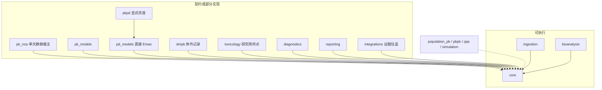

# 架构

PharmacoWeave 0.0.4 是一个研究用的数据与证据工具包。计算模块依赖 `core`。`core` 不依赖分析模块。集成模块导出证据并做文件级守卫，不导入其他 Weave 项目。

## 运行路径

1. `PharmacologyStudy.from_files` 读取 `study_metadata.json` 以及 CSV、TSV 或 Parquet 表。
2. 单条记录的规则在 Pydantic 模型里执行：时区、剂量维度、BLQ 不得带数值、输注必须有时长。
3. `study.check` 执行跨记录规则：外键、时钟、LLOQ、基质、身份链接和外部证据。
4. `export_bundle` 在校验通过后写出新的结果目录。目录已存在时拒绝覆盖。
5. `run_nca` 对单次静脉推注轮廓做 NCA。其他设计在配置或轮廓构建时被拒绝。

`check` 这个名字是为了避开 `BaseModel.validate`。命令行和 `from_files(..., validate_schema=True)` 仍然表达“做校验”。

## 记录规则

- 研究、受试者、化合物、分析物、检测、给药、样本、观测是分开的类型。
- 受试者是统计单位。技术重复用 `replicate_id`，不是新的受试者。
- 剂量的主字段是实际给药量（药物质量或物质的量）。`mg/kg` 写在归一化字段里，并与体重核对。
- 样本同时保存绝对时间和相对给药时间，并声明 `timebase_id`。负的相对时间必须标成 predose。
- 浓度观测必须指向分析物和浓度型检测。检测物基质与样本基质不一致时校验失败。
- 模型说明必须写下 question of interest 和 context of use。这两个字段记录使用场景，填写它们不等于完成 MIDD 证据评价。
- 诊断或拟合要标成 pass，必须同时写下局限性。拟合还要 `converged=true`。

## 结果包

写出的目录包含研究表、实验表、来源、软件版本、运行时、证据、身份链接、校验 JSON 和 HTML 清单。每个文件有 SHA-256。`manifest.json` 自身的摘要写在 `manifest.sha256`。

未运行分析时 `analysis_executed` 为 false。NCA、拟合参数、预测、残差、诊断图和 PK 报告列在 `omitted`，并说明缺席原因。缺文件因此表示“没有运行分析”，而不是“分析产生了空表”。`pharmacoweave nca --bundle` 会把 `analysis_executed` 设为 true，并写入 NCA 表、浓度–时间图，以及一室静脉推注对数线性拟合的参数、残差和拟合优度图。只传入 NCA 结果、不传入拟合时，不会补造拟合图。

`provenance/runtime.json` 记录写出校验包的解释器。它不是密封的分析环境锁；`environment.lock` 也列在 `omitted`。

## 证据边界

外部 JSON 先过 `EvidenceExchange`，再过项目规则：

- 实测浓度只存在于观测表。证据交换里的 `observed` + `concentration` 会被拒绝。
- OmicsWeave 的通量、丰度或通路不能标成浓度、清除率、AUC、半衰期或分布容积。
- TheraWeave 可以附带 `predicted` ADMET。它不能提供 `observed` 或 `estimated` 的 PK。
- 预测、文献和假设不能使用 `qc_status=accepted`。
- EphysWeave 的神经或行为终点必须带 `subject_id`、`session_id`、`timebase_id` 和 `sync_error_ms`。读取函数不移动时钟，也不做插值。
- `promote_to_observation` 一律拒绝。证据等级留在证据记录上。
- PharmacoWeave 写出的证据必须有非空的 `derived_from`。预测效应不能改写成 observed。

身份链接只有 `review_status=accepted` 且指向本研究所内受试者时，才有资格在以后被用于连接。本版本不做这个连接。

## 部分实现和预留包

`pd_models` 估计基线固定、Hill 系数为 1 的直接效应 Emax。`pkpd` 把实测直接效应连到显式浓度，拒绝把 AUC 或 Cmax 当作该浓度。`dmpk` 校验体外通透性、微粒体清除率和肝细胞清除率，不换算成体内 CL。`toxicology` 保存链接到剂量或暴露的研究用终点，不生成临床剂量。

`population_pk`、`pbpk`、`qsp`、`simulation` 只导出 `STATUS`，`execution=reserved`。`pharmacoweave capabilities` 打印同一张表。

## 依赖方向

允许：`ingestion`、`bioanalysis`、`pk_nca`、`pk_models`、`pd_models`、`dmpk`、`toxicology`、`diagnostics`、`reporting` 依赖 `core`。`pkpd` 依赖 `pd_models`。`integrations` 依赖 `core` 和这些记录的公开类型，用来写出证据。

不允许：`core` 依赖上述业务包；任何模块导入 OmicsWeave、TheraWeave、EphysWeave、PKNCA、nlmixr2、PK-Sim 或 NONMEM。

`schema_export` 从模型生成 `schemas/`。测试比较两边的 JSON。
