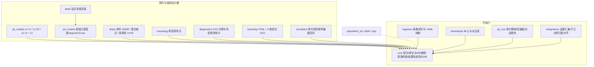

# 架构

PharmacoWeave 0.2.0 是一个研究用的定量药理学数据、统计估计与证据工具包。计算模块依赖 `core`；`core` 在模块顶层不依赖任何分析业务包。集成模块导出证据、校准跨尺度时序并做文件级守卫，不导入其他 Weave 项目或外部 GPL/专有求解器。可执行的外部后端只有本包自己的 MIT 解析参考引擎，通过子进程交换文件。

## 运行路径

1. `PharmacologyStudy.from_files` 或 `PharmacologyStudy.from_mapping` 读取标准研究目录或通过 `ingest_mapping.yaml` 读取异构原始实验室表格（严格计算并保留原始文件 SHA-256 摘要）。
2. 单条记录的规则在 Pydantic 模型里执行：时区、剂量维度、BLQ 不得带数值、输注必须有时长、正参数置信区间必须为正、游离分数 `fu` 严格在 `(0, 1]` 范围。
3. `study.check` 执行跨记录规则：外键、时钟、LLOQ（支持显式分子量下的摩尔/质量限值转换）、基质、身份链接和外部证据。
4. `study.bridge_effects` 与 `study.bridge_toxicology` 将研究表原始观测（`effect` / `toxicity`）桥接为强类型领域记录（`EffectObservation` 与 `ToxEndpoint`）。
5. `collapse_replicates` 可选对同一给药后时间点的定量浓度平行样执行算术或几何均值聚合，记录 CV% 与溯源 ID，绝不把 BLQ 纳入均值或改为 0。
6. `run_nca`、`fit_iv_bolus` / `fit_one_compartment_extravascular` / `fit_two_compartment_iv_bolus`、`fit_linked_direct_emax` / `fit_sigmoid_emax`、`predict_hepatic_clearance_well_stirred`（探索性 Well-Stirred IVIVE，需显式生理与结合参数，输出锁定 `predicted` 等级）、`audit_study_predictions`（先验预测对体内实测折叠误差审计）、`align_cross_project_endpoint`（跨尺度电生理/组学对齐）以及 `simulate_exposure`（显式参数下的单次给药解析暴露区间，输出锁定 `predicted`）在各自契约边界内执行计算。
7. `export_bundle` 在校验通过后写出新的不可变结果目录，自动物化 `analysis/derived_observations.parquet`、可选 `analysis/ivive_predictions.parquet`、`analysis/prediction_audit.json` 与 `analysis/exposure_simulation.json`，汇集并核验 `evidence/pharmacology_evidence.json`。目录已存在时拒绝覆盖。
8. `verify_bundle` 与 `diff_bundles` 提供离线结果包密码学哈希/Schema 完整性复核与跨次运行结果包深度对比。`run_backend("pharmacoweave-analytical")` 在独立子进程中重复第 6 步的解析模拟；`nlmixr2` 与 PK-Sim 只被登记为 copyleft，不被启动。

## 记录规则

- 研究、受试者、化合物、分析物、检测、给药、样本、观测是分开的类型。
- 受试者是统计单位。技术重复用 `replicate_id`，不是新的受试者。
- 剂量的主字段是实际给药量（药物质量或物质的量）。`mg/kg` 写在归一化字段里，并与体重核对。
- 样本同时保存绝对时间和相对给药时间，并声明 `timebase_id`。负的相对时间必须标成 predose。
- 浓度观测必须指向分析物和浓度型检测。检测物基质与样本基质不一致时校验失败。
- 模型说明必须写下 question of interest 和 context of use。诊断或拟合要标成 pass，必须同时写下局限性，且 `converged=true`。

## 结果包

写出的目录包含研究表、实验表、派生观测表、分析参数与残差表、SVG 诊断图、来源、软件版本、运行时、证据、身份链接、校验 JSON 和 HTML 报告。每个文件都有 SHA-256，`manifest.json` 自身的摘要写在 `manifest.sha256`。

未运行分析时 `analysis_executed` 为 `false`，未执行的表与图列在 `omitted` 并说明缺席原因。`pharmacoweave nca --bundle` 默认只执行纯 NCA（写入 `nca_parameters.parquet`、`derived_observations.parquet`、线性与半对数浓度–时间图及 NCA 证据），不隐式运行房室拟合；需要同时拟合并输出残差图时可显式传入 `--with-fit` 或使用 `pharmacoweave fit --bundle`。`pharmacoweave emax --study ... --bundle ...` 写出 Emax 参数表、预测表和浓度–效应拟合图。

## 证据边界

外部或本运行生成的 JSON 均通过 `EvidenceExchange` 与 `screen_exchange` 守卫：

- 实测浓度只存在于观测表。证据交换里的 `observed` + `concentration` 会被拒绝。
- OmicsWeave 的通量、丰度或通路不能标成浓度、清除率（含表观清除率 `apparent_clearance`）、AUC、半衰期或分布容积（含表观分布容积 `apparent_volume`）。
- 血管外给药在生物利用度 `F` 未知时导出的证据固定为 `apparent_clearance`（`CL_over_F`）与 `apparent_volume`（`Vz_over_F` / `V_over_F`），绝不标为静脉 `clearance` 或 `volume`。
- TheraWeave 可以附带 `predicted` ADMET，不能提供 `observed` 或 `estimated` 的 PK。
- 探索性 IVIVE 导出的清除率固定为 `predicted` 等级（`claim_type="ivive_hepatic_plasma_clearance"`），绝不标为体内实测或估算清除率，且严禁由 IVIVE 推导首次人体推荐剂量。
- 先验预测校准审计保持输入证据只读，严格隔离绝对清除率与表观清除率（$CL$ vs $CL/F$）、绝对体积与表观体积（$V$ vs $V/F$）、通用参数与两室参数（排除 $Q$、$V2$）以及母药与代谢物。
- 预测、文献和假设不能使用 `qc_status=accepted`。
- EphysWeave 的神经或行为终点必须带 `subject_id`、`session_id`、`timebase_id` 和 `sync_error_ms`。读取函数不移动时钟，也不做插值。
- `promote_to_observation` 一律拒绝。PharmacoWeave 写出的证据必须带非空 `derived_from`。模型预测效应始终保持 `predicted`。

## 依赖方向

允许：`ingestion`、`bioanalysis`、`pk_nca`、`pk_models`、`pd_models`、`dmpk`、`toxicology`、`diagnostics`、`reporting` 依赖 `core`。`pkpd` 依赖 `pd_models`。`simulation` 依赖 `pk_models` 里已经验收的解析解。`integrations` 依赖 `core` 和这些记录的公开类型，用来写出证据，并通过子进程调用 `pharmacoweave-analytical`。

不允许：`core` 在模块顶层依赖上述业务包；任何模块导入 OmicsWeave、TheraWeave、EphysWeave、PKNCA、nlmixr2、PK-Sim 或 NONMEM。
