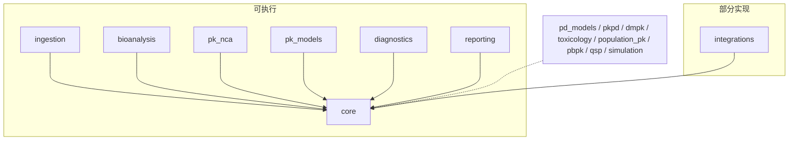

# 架构

PharmacoWeave 0.1.0 是研究用的数据与分析工具包。可执行范围是数据契约、锁定设计的 NCA，以及一室静脉推注拟合。计算模块依赖 `core`。数据模型不在导入时依赖分析包；`PharmacologyStudy` 的分析方法在调用时再导入它们。结果包写入器导入校验报告渲染器，以便没有分析时仍能写出 HTML 清单。集成模块只依赖已经版本化的证据契约，不导入其他 Weave 项目。

## 运行路径

1. `PharmacologyStudy.from_files` 读取 `study_metadata.json` 以及 CSV、TSV 或 Parquet 表。
2. 单条记录的规则在 Pydantic 模型里执行：时区、剂量维度、BLQ 不得带数值、输注必须有时长。
3. `study.check` 执行跨记录规则：外键、时钟、LLOQ、基质、身份链接和外部证据。
4. `export_bundle` 在校验通过后写出新的结果目录。目录已存在时拒绝覆盖。
5. `export_bundle` 不运行 NCA 或拟合。`analysis_executed` 保持 false。
6. `run_nca` 加载锁定配置并计算 NCA。超范围设计抛出 `UnsupportedDesign`。
7. `fit_one_compartment_iv_bolus` 估计 CL 与 V。失败的拟合不写出估计。
8. `export_analysis_bundle` 或 `pharmacoweave analyze` 写出分析产物，并把 `analysis_executed` 设为 true。

`check` 这个名字是为了避开 `BaseModel.validate`。命令行和 `from_files(..., validate_schema=True)` 仍然表达“做校验”。

## 记录规则

- 研究、受试者、化合物、分析物、检测、给药、样本、观测是分开的类型。
- 受试者是统计单位。技术重复用 `replicate_id`，不是新的受试者。
- 剂量的主字段是实际给药量（药物质量或物质的量）。`mg/kg` 写在归一化字段里，并与体重核对。
- 样本同时保存绝对时间和相对给药时间，并声明 `timebase_id`。负的相对时间必须标成 predose。
- 浓度观测必须指向分析物和浓度型检测。检测物基质与样本基质不一致时校验失败。
- 模型说明必须写下 question of interest 和 context of use。这两个字段记录使用场景，填写它们不等于完成 MIDD 证据评价。
- 诊断或拟合要标成 pass，必须同时写下局限性。拟合还要 `converged=true`。

## 结果包

写出的目录包含研究表、实验表、来源、软件版本、运行时、证据、身份链接、校验 JSON 和 HTML 清单。每个文件有 SHA-256。`manifest.json` 自身的摘要写在 `manifest.sha256`。

只做校验时，`analysis_executed` 为 false。NCA、参数、预测、残差、诊断和 PK 报告出现在 `omitted`，并说明缺席原因。分析真正运行后，清单改为 true，并写入实际算出的表和图。失败或按规则省略的产物仍留在 `omitted`，缺文件表示“没有这份结果”，而不是“分析产生了空表”。

`provenance/runtime.json` 记录写出校验包的解释器。它不是密封的分析环境锁；`environment.lock` 也列在 `omitted`。

## 证据边界

外部 JSON 先过 `EvidenceExchange`，再过项目规则：

- 实测浓度只存在于观测表。证据交换里的 `observed` + `concentration` 会被拒绝。
- OmicsWeave 的通量、丰度或通路不能标成浓度、清除率、AUC、半衰期或分布容积。
- TheraWeave 可以附带 `predicted` ADMET。它不能提供 `observed` 或 `estimated` 的 PK。
- 预测、文献和假设不能使用 `qc_status=accepted`。
- EphysWeave 的神经或行为终点必须带 `subject_id`、`session_id`、`timebase_id` 和 `sync_error_ms`。读取函数不移动时钟，也不做插值。
- `promote_to_observation` 一律拒绝。证据等级留在证据记录上。

身份链接只有 `review_status=accepted` 且指向本研究所内受试者时，才有资格在以后被用于连接。本版本不做这个连接。

## 预留包

后期包只导出 `STATUS`。阶段和 `execution=reserved` 来自 `pharmacoweave.core.roadmap`。`pharmacoweave capabilities` 打印同一张表。

## 依赖方向

允许：`ingestion`、`bioanalysis`、`pk_nca`、`pk_models`、`diagnostics`、`reporting`、`integrations` 依赖 `core`。

不允许：`core` 依赖上述业务包；任何模块导入 OmicsWeave、TheraWeave、EphysWeave、nlmixr2、PK-Sim 或 NONMEM。

`schema_export` 从模型生成 `schemas/`。测试比较两边的 JSON。
