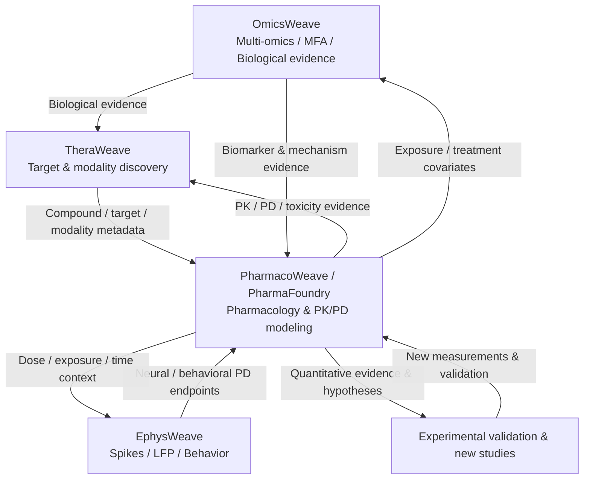

# PharmacoWeave / PharmaFoundry：定量药理学平台架构与多系统协作规划

> **文档类型**：项目立项与技术架构设计（Markdown）  
> **版本**：v0.1 — 2026-10-30；完成状态注记更新于 2026-11-10  
> **项目状态**：仓库已建立。包名采用 PharmacoWeave。立项 Phase 0–3 已可运行。Phase 4 原文中的重型 PopPK、PBPK 与 QSP 未实现；收窄后的切片完成至 0.2.5，五项有限函数完成于 0.2.6。对照表见 `docs/project-evaluation.md` 与 `docs/roadmap.md`。  
> **候选项目名**：**PharmacoWeave**（已采用的包名）或 **PharmaFoundry**（未采用）  
> **建议定位**：*A Python Toolkit for Quantitative Pharmacology, DMPK, PK/PD Modeling and Translational Evidence*

---

## 1. 项目摘要与核心决策

### 1.1 建议结论

建议**新建一个独立 Git 仓库与 Python 分发包**，专门承载药代动力学（PK）、药效学（PD）、药物代谢与药代动力学（DMPK）、毒理学及定量系统药理学（QSP）相关实验数据处理、模型估计、模拟、验证和报告输出。

保留如下职责边界：

- **OmicsWeave**：分子组学、代谢通量分析（MFA）、跨组学证据及生物学机制发现。
- **TheraWeave**：治疗靶点发现、治疗模态比较、候选分子与干预方案评价；可以含**预测性** ADMET 筛选。
- **EphysWeave**：Plexon `.plx`、Spike/LFP、行为事件对齐及神经功能表型分析。
- **PharmacoWeave / PharmaFoundry**：**实测药理实验数据的定量分析**、NCA、PK/PD、DMPK、毒理/毒代动力学（TK）、模型验证及实验性药理证据输出。

> 核心边界：**预测的药物性质 ≠ 实测 PK/PD 结果；分子或组学相关性 ≠ 已确立的药理作用；模型模拟 ≠ 经验证的临床结论。**

### 1.2 关键架构选择

| 决策项 | 推荐方案 | 理由 |
|---|---|---|
| Git 仓库 | 与其他 Weave 项目分开的独立仓库 | 数据模型、计算框架、验证要求不同 |
| 初期 Python 包 | 单一分发包 + 独立功能模块 | 降低维护和发布复杂度 |
| 模块装配 | 可选依赖（extras）+ 插件式后端适配器 | 轻量起步，按需启用重型建模引擎 |
| 数据交换 | 版本化 JSON Manifest + Parquet 数据表 + 引用关系 | 不要求各项目互装彼此 Python 包 |
| 首版范围 | 生物分析数据导入、NCA、基础 PK 拟合、诊断、HTML 报告 | 最快形成可复现、可验证的可用软件 |
| 后续扩展 | PD/PKPD、DMPK、TK/毒理、PopPK、PBPK、QSP | 根据真实数据和验证能力逐步添加 |
| 上游/下游对接 | 输入/输出 `Evidence Bundle`，保留来源与版本 | 支持跨软件研究闭环 |
| 临床/申报用途 | 初始标识为 Research Use；不默认具备监管验证资格 | 避免对软件适用性作过度承诺 |

---

## 2. 系列软件生态及职责边界

### 2.1 系统全景



**说明**：图示为逻辑层的数据关系，不要求各仓库彼此产生运行时依赖，也不暗示各类数据可以未经实验设计匹配直接合并。

### 2.2 四个项目的核心对象

| 系统 | 核心实体 | 核心成果 | 不应承担的主要职责 |
|---|---|---|---|
| OmicsWeave | Gene、Transcript、Protein、Metabolite、Reaction、Pathway、BiologicalEvidence | 差异特征、通路、MFA 结果、机制与靶点假设 | 通用 PK 模型求解、毒理学数据管理 |
| TheraWeave | Target、Compound、TherapeuticModality、Candidate、InterventionHypothesis | 候选治疗方案、可成药性及多维证据 | 作为所有实测 PK/PD 数据的核心系统 |
| EphysWeave | Session、Unit、SpikeTrain、LFP、BehaviorEvent、Trial | 电生理功能终点与行为表型 | 药物清除率、药物体内分布参数估计 |
| PharmacoWeave | Study、Subject、DoseEvent、Sample、Analyte、Observation、PKModel、PKPDEvidence | PK 参数、暴露–效应、模型、毒性证据 | 重新实现组学差异分析或分子生成算法 |

### 2.3 典型跨项目工作流

**工作流 A：靶点发现与候选优化**

1. OmicsWeave 输出候选靶点、通路及可追溯的组学证据。
2. TheraWeave 结合外部知识、靶点作用模式和治疗模态筛选候选方案。
3. 药理实验产生血浆/组织浓度、PD 指标、ADME 与毒理数据。
4. PharmacoWeave 完成 NCA、模型拟合、暴露–效应与安全性证据评估。
5. 经审核的药理结果以新 Evidence 记录回流 TheraWeave，辅助候选再评价。

**工作流 B：药物干预后的多组学机制**

1. PharmacoWeave 记录药物、剂量、途径、给药时间和暴露参数。
2. OmicsWeave 将匹配样本的转录组、蛋白组、代谢组和 MFA 结果关联到实验处理条件。
3. 在实验设计允许时研究暴露–分子表型关系；对同一个体、组织和时间点的匹配进行显式核查。
4. 相关性分析结果作为机制线索返回，而非自动宣称因果药效机制。

**工作流 C：神经电生理学药效终点**

1. EphysWeave 从 Plexon `.plx` 与行为数据中提取 PSTH、发放率、频段功率或任务表现等指标。
2. 提供 `subject_id`、`session_id`、`event_time`、`timebase_id`、`sync_error_ms` 和 QC。
3. PharmacoWeave 使用给药事件和暴露/浓度数据，与电生理 PD 终点建立时间对齐模型。
4. 对跨设备时间同步误差、重复测量结构和不同动物/Session 间不匹配进行显式检查。

---

## 3. 产品范围与需求优先级

### 3.1 最小可行版本（MVP：P0）

| 模块 | 需求 | 核心输出 |
|---|---|---|
| `ingestion` | 读取 CSV/TSV/Parquet，字段映射、单位识别、Schema 验证 | 标准化实验记录与审计报告 |
| `bioanalysis` | 浓度测定导入、分析物/基质、LLOQ、QC、BLQ/缺失标记 | 可追溯的浓度观测表 |
| `pk_nca` | 适用于支持的研究设计的非房室分析 | AUC、Cmax、Tmax、t½、清除率等（按适用性） |
| `pk_models` | 预定义一室/二室模型及明确的给药途径、拟合和误差模型 | 参数估计、拟合/预测值、残差 |
| `diagnostics` | 拟合优度图、残差分析、参数可辨识性/不确定性检查 | 诊断指标、限制与警告 |
| `reporting` | 单次运行的 HTML 报告和机器可读结果包 | 报告 + JSON/Parquet + 图表 |
| `validation` | 基准测试、单位测试、边界条件与回归测试 | 可核查的验证记录 |

NCA 参数的输出依赖给药途径和数据充分性。例如，**静脉给药与非静脉给药的清除率/表观清除率不能混标**；终末相不可靠时不应无条件报告 t½、AUC∞ 等参数。

### 3.2 第一轮扩展（P1）

- `pd_models`：直接效应 Emax / Sigmoid Emax 等模型，并明确药效终点、时间尺度及量纲。
- `pkpd`：浓度–效应关联、联合 PK/PD 拟合、滞后与间接反应模型（按数据需求）。
- `dmpk`：体外稳定性、蛋白结合、清除率、组织分布、代谢相关实验结果组织与推断。
- `toxicology`：毒性终点的定量描述、剂量–反应与毒代动力学（TK）数据关联。
- `integrations`：与 TheraWeave、OmicsWeave、EphysWeave 的首批文件级适配器。

### 3.3 远期功能（P2/P3）

- `population_pk`：群体 PK / NLME、个体间变异、协变量影响与模型预测检验。
- `pbpk`：器官/组织分布及生理参数驱动的 PBPK 分析。
- `qsp`：通路/网络机制性 QSP 建模与跨组学参数关联。
- `simulation`：经过模型适用性论证的研究方案比较、敏感性分析、不确定性传播。
- `translational`：跨物种参数解释与转化研究，但必须记录外推假设与适用范围。

**不在早期范围内**：完整取代 PK-Sim/MoBi、nlmixr2、NONMEM 或其他成熟建模引擎；以未验证的模型自动给出临床给药建议；从少量数据自动推断临床安全性。

---

## 4. 核心实验数据模型

建议采用**规范化实体 + 长表观测 + 可复现模型对象**，避免将剂量、浓度、效应、毒理结果混入一个无类型的大型 DataFrame。

### 4.1 主实体及标识符

| 实体 | 建议字段 | 备注 |
|---|---|---|
| `Study` | `study_id`, `protocol_id`, `study_type`, `species`, `design_version` | 描述设计与实验上下文 |
| `Subject` | `subject_id`, `study_id`, `group_id`, `species`, `sex`, `covariates` | 实验对象/个体为统计层级 |
| `Compound` | `compound_id`, `name`, `structure_ref`, `molecular_weight`, `formulation_ref` | 与 TheraWeave ID 可建立映射 |
| `Analyte` | `analyte_id`, `compound_id`, `analyte_role`, `matrix` | 原药、活性代谢物、生物标志物等需区分 |
| `DoseEvent` | `dose_event_id`, `subject_id`, `compound_id`, `timestamp`, `dose_value`, `dose_unit`, `route`, `formulation` | 实际给药事件，不只记录计划剂量 |
| `Biosample` | `sample_id`, `subject_id`, `collection_time`, `matrix`, `collection_site`, `timebase_id` | 样本与对应个体/给药事件关联 |
| `Observation` | `observation_id`, `sample_id`, `analyte_id`, `value`, `unit`, `status`, `assay_id` | 浓度/药效/毒理需有明确 `observation_type` |
| `Assay` | `assay_id`, `method`, `calibration_id`, `LLOQ`, `ULOQ`, `qc_status` | 方法学和生物分析质量 |
| `ModelSpec` | `model_id`, `model_type`, `equations_ref`, `parameters`, `error_model`, `assumptions` | 与数据版本和拟合任务分离 |
| `ModelFit` | `fit_id`, `model_id`, `dataset_id`, `software_version`, `diagnostic_status` | 每次拟合不可覆盖历史记录 |
| `ParameterEstimate` | `fit_id`, `parameter`, `value`, `unit`, `SE/CI`, `estimation_method` | 含参数边界和不确定性 |
| `PharmacologyEvidence` | `evidence_id`, `claim_type`, `source_refs`, `assessment`, `limitations` | 独立于候选治疗假设 |

建议将 ID 的命名空间、类型和来源保存在独立的 `identity_map` 表中。不同仓库即使使用相同的 `subject_id` 文本，也**不得默认属于同一实验对象**。

### 4.2 时间与给药事件

- 同时记录**绝对时间**（例如 UTC ISO 8601）和相对于明确参考事件的时间（如 `time_since_dose_h`）。
- 多次给药应以多个 `DoseEvent` 表示；不得丢失给药顺序、剂量、途径与实际时间。
- 记录采样时间、检测时间、动物/受试者标识以及原始采集设备的时间基准。
- 跨 EphysWeave 的行为/神经记录应附带对齐方式、漂移校正和时间误差。
- 单位须显式声明并严格验证，尤其是 `mg/kg`、`mg`、`nmol/L`、`µg/mL`、`h` 与 `min`。
- 必须区分 `dose`（给药剂量）、`exposure`（暴露量）、`concentration`（测量浓度）与 `effect`（药理效应）。

### 4.3 特殊观测、缺失与质量控制

建议为观测增加：

- `status`: `quantified` / `BLQ` / `above_ULOQ` / `missing` / `invalid`；
- `raw_value`、`reported_value`、`numeric_value`，禁止用 0 默默替代 BLQ；
- `qc_flags`、`exclusion_reason`、`replicate_id`、`assay_batch_id`；
- 样本基质与取样部位，例如 plasma、serum、CSF、brain tissue 等；
- 检测对象究竟是总量、游离型、原药、代谢物还是受体占用率。

BLQ 处理、异常值剔除、缺失数据插补等规则应以**可配置、可审计**的分析策略实现，不能隐藏在预处理步骤里。

### 4.4 统计层级

统计分析必须区分：生物学个体、时间点、技术重复、组织/样本、分析批次。重复取样的 PK 浓度观测不是独立受试者。多组学、电生理、药理数据整合时须保留层级与配对关系。

---

## 5. 分析与模型数据结构

### 5.1 NCA 输出

建议最少包含：

- `subject_id` / `cohort_id`、`analyte_id`、`route`、`dose_event_ref`；
- `auc_last`、`auc_inf`（仅满足要求时）、`cmax`、`tmax`、`lambda_z`、`half_life`；
- 估计方法（线性/对数梯形规则等）、所用数据点、终末相选择及回归统计；
- 参数单位、计算方法、QC 标记、排除原因和数据覆盖范围；
- 非静脉给药的 `CL/F`、`V/F` 等应与静脉给药的 `CL`、`V` 做语义区分。

### 5.2 PK/PD 模型输出

- 模型结构、方程、状态变量与输入函数；
- 个体/总体参数、参数约束、初值、估计算法和优化收敛信息；
- 观察数据、模型预测、个体预测、残差与误差模型；
- 参数置信区间或其他不确定性描述；
- 模型选择依据、拟合优度、敏感性分析及模型适用场景（Context of Use）；
- 不能根据拟合优度单项判断模型机制正确性或外推能力。

### 5.3 药效学与毒理模型

PD 端点应附带明确的**检测方法、组织/细胞、时间、效应方向和单位**。毒理端点应记录实验类别、剂量/暴露、严重程度、发生频率、病理证据和不确定性；不能仅依据一组动物实验输出临床安全性标签。

### 5.4 不同治疗模态的差异

| 模态 | 建模关注 | 架构要求 |
|---|---|---|
| 小分子 | 吸收、分布、代谢、清除、受体作用 | 标准 PK/PD 与 ADME 模块 |
| 多肽 | 降解、组织分布、受体介导清除 | 可扩展清除/动力学组件 |
| mRNA / siRNA / ASO | 递送、组织/细胞摄取、表达或沉默时程 | 载体与作用持续时间对象 |
| 基因编辑 | 递送暴露、编辑效率与长期效应 | 递送动力学和持久效应分离建模 |

不得将所有模态强行拟合为相同的一室血浆浓度模型。

---

## 6. 标准化 PharmacologyResultBundle

每次运行必须产生具有稳定 ID 和可追溯来源的结果包：

```text
results/
└── study_001_run_001/
    ├── manifest.json
    ├── provenance/
    │   ├── source_files.json
    │   ├── analysis_parameters.json
    │   ├── software_versions.json
    │   └── environment.lock
    ├── study/
    │   ├── study_metadata.json
    │   ├── subjects.parquet
    │   ├── compounds.parquet
    │   ├── analytes.parquet
    │   └── identity_map.parquet
    ├── experimental/
    │   ├── dosing_events.parquet
    │   ├── biosamples.parquet
    │   ├── concentration_observations.parquet
    │   ├── pd_observations.parquet
    │   └── toxicology_observations.parquet
    ├── analysis/
    │   ├── nca_parameters.parquet
    │   ├── model_parameters.parquet
    │   ├── predictions.parquet
    │   ├── residuals.parquet
    │   └── diagnostics.json
    ├── evidence/
    │   ├── pharmacology_evidence.json
    │   └── cross_project_links.json
    ├── qc/
    │   ├── ingest_validation.json
    │   └── quality_metrics.json
    ├── figures/
    │   ├── concentration_time.svg
    │   ├── goodness_of_fit.svg
    │   └── residual_diagnostics.svg
    └── reports/
        └── analysis_report.html
```

输出约束：

1. `manifest.json` 包含 Schema 版本、生成软件版本、研究/运行 ID、相对路径、文件校验和及创建时间。
2. `evidence` 只引用经明确映射的数据，不复制或静默修改其他项目结论。
3. 表格保存结构化数值，HTML/PDF 仅为呈现形式，不作为机器交换接口。
4. 输入、参数、结果、排除决定和警告可以反向追溯。
5. 独立运行的结果包不要求安装 TheraWeave、EphysWeave 或 OmicsWeave。

### 6.1 Manifest 示例（纯设计示意）

```json
{
  "schema_name": "pharmacology-result-bundle",
  "schema_version": "0.1.0",
  "run_id": "demo_run_001",
  "study_id": "study_example",
  "producer": {
    "software": "PharmacoWeave",
    "version": "0.1.0"
  },
  "data": {
    "dosing_events": "experimental/dosing_events.parquet",
    "concentrations": "experimental/concentration_observations.parquet",
    "nca": "analysis/nca_parameters.parquet"
  },
  "source_bundles": [],
  "quality_status": "research_only",
  "provenance": "provenance/source_files.json"
}
```

示例中的路径和版本均为规划草案，实际实现时应为每种分发包建立 Schema 测试和文件校验规则。

---

## 7. 跨项目证据交换契约（Evidence Exchange Contract）

### 7.1 接口优先级

首版推荐**文件交换优先**：JSON + Parquet + 明确的 Schema/ID 映射；后续有多人协作和远程调用需求时才扩展 REST API 或数据库服务。

所有对外交换包必须至少包含：

- `schema_name` / `schema_version`；
- `source_project` / `source_run_id` / `source_artifact_id`；
- `study_id`、`subject_id` 等带命名空间的身份信息（若适用）；
- `entity_type`、`entity_id`、`measurement_type`、`unit`、`time_context`；
- `evidence_type`：`observed` / `estimated` / `predicted` / `literature` / `hypothesis`；
- `qc_status`、不确定性、适用范围及来源文献/文件；
- `provenance`：算法、参数、依赖、数据库版本与审核记录。

### 7.2 主要接口清单

| 起点 → 终点 | 数据契约 | 必须避免的误用 |
|---|---|---|
| OmicsWeave → PharmacoWeave | `BiomarkerEvidence`、`PathwayEvidence`、`Metabolite/FluxObservation` | 把 MFA 通量直接当作药物浓度或药效参数 |
| PharmacoWeave → OmicsWeave | `TreatmentExposureContext`、`StudyCovariates` | 不验证同体/同时间点就连接结果 |
| TheraWeave → PharmacoWeave | `CandidateCompound`、`TargetHypothesis`、`TherapeuticModality` | 把预测 ADMET 当成已测实验证据 |
| PharmacoWeave → TheraWeave | `PharmacologyEvidence`、`ExposureResponseSummary`、`SafetySignal` | 用不充分动物数据直接宣布安全/有效 |
| EphysWeave → PharmacoWeave | `NeuralPDObservation`、`BehavioralEndpoint`、`SynchronizationMetadata` | 忽略设备时钟漂移和重复测量结构 |
| PharmacoWeave → EphysWeave | `DoseEvent`、`ExposureEstimate`、`TreatmentContext` | 在时钟基准未知时强行插值对齐 |

### 7.3 研究对象跨项目匹配

**匹配原则**：应使用独立的 `identity_map`，其中记录 `source_project`、`source_study_id`、`source_subject_id`、`canonical_subject_id`、匹配方法与审核状态。对于不同实验中的同品系小鼠、同组织或者同药物，不可凭文本名称判断是同一实验样本。

同时在跨物种分析中记录 NCBI Taxonomy ID、蛋白/基因命名空间和组织词表。人鼠同源基因映射不能等同于作用机制已在人体确证。

### 7.4 证据更新策略

- 上游 Bundle 尽量视为**不可变快照**；所有更新生成新的 `run_id` 或修订版。
- 下游模型结果以 `derived_from` 引用其上游来源。
- 对结果的人工审核、模型否证、重复实验结果作为新的 Evidence，而不是覆盖旧值。
- 明确区分 `not_measured`、`missing`、`negative_result`、`BLQ`、`failed_qc`。
- Evidence 可以作为研发决策支持，**不自动转化为治疗推荐、临床方案或已验证因果结论**。

### 7.5 Python API（未来目标，非现有可运行代码）

```python
from pharmacoweave import PharmacologyStudy
from pharmacoweave.integrations import import_candidate_bundle

study = PharmacologyStudy.from_files(
    "data/experiment_001/",
    validate_schema=True,
)

study.attach_candidates(import_candidate_bundle("theraweave_candidates/"))
nca = study.run_nca(config="configs/nca.yaml")
study.export_bundle("results/study_001_run_001/")
```

正式 API 应在 MVP 验证后冻结；早期优先稳定 Schema，不要为了接口形式牺牲数据质量。

---

## 8. Python 仓库与模块结构

采用单仓库单 Python 包的起点，保留未来拆分包的可能：

```text
PharmacoWeave/                   # 若采用 PharmaFoundry，则同步调整名字
├── README.md
├── LICENSE
├── CITATION.cff
├── pyproject.toml
├── CHANGELOG.md
├── CONTRIBUTING.md
├── docs/
│   ├── architecture.md
│   ├── data-contracts.md
│   ├── validation.md
│   └── interoperability.md
├── src/
│   └── pharmacoweave/
│       ├── __init__.py
│       ├── core/
│       │   ├── entities.py
│       │   ├── units.py
│       │   ├── provenance.py
│       │   └── validation.py
│       ├── ingestion/
│       ├── bioanalysis/
│       ├── pk_nca/
│       ├── pk_models/
│       ├── pd_models/
│       ├── pkpd/
│       ├── dmpk/
│       ├── toxicology/
│       ├── population_pk/
│       ├── pbpk/
│       ├── qsp/
│       ├── simulation/
│       ├── diagnostics/
│       ├── reporting/
│       └── integrations/
│           ├── omicsweave.py
│           ├── theraweave.py
│           ├── ephysweave.py
│           └── external_backends.py
├── schemas/
│   ├── result_bundle.schema.json
│   └── evidence_exchange.schema.json
├── tests/
│   ├── unit/
│   ├── integration/
│   ├── numerical_benchmarks/
│   ├── schema_contracts/
│   └── regression/
├── examples/
│   ├── 01_pk_nca.ipynb
│   ├── 02_compartment_pk.ipynb
│   ├── 03_exposure_pd.ipynb
│   └── cross_project_demo/
├── configs/
└── .github/workflows/
    ├── ci.yml
    └── publish.yml
```

**依赖方向**：`core` 不依赖上层业务模块；`pk_nca/pk_models/pd_models/...` 依赖 `core`；`integrations` 依赖稳定公开接口。**不得直接导入**其他 Weave 项目未经公开或版本化的内部实现。

### 8.1 技术栈（候选，需在立项时锁定版本）

- 基础数据：NumPy、pandas、PyArrow；大规模/复杂数据可考虑 xarray。
- 参数估计与数值计算：SciPy；求解 ODE 时视需求选择相应后端。
- 单位系统：Pint 等；项目强制显式单位校验。
- Schema：Pydantic + JSON Schema；对表格采用额外字段校验。
- 报告：Jinja2、Matplotlib/Plotly，HTML 为首选可阅读输出。
- 可选外部引擎：Open Systems Pharmacology / PK-Sim、MoBi；nlmixr2（R）；其他第三方工具，须通过适配器和版本控制接入。
- 开发：pytest、Ruff、mypy/pyright（按团队选择）、pre-commit、GitHub Actions、uv 或类似依赖工具。

大型 PBPK/PopPK 引擎建议**适配现有软件**而非重新实现。运行引擎的许可证、版本、输出格式、执行环境和数值差异需要记录。

### 8.2 安装策略（仅示意）

```bash
pip install pharmacoweave
pip install "pharmacoweave[pkpd]"
pip install "pharmacoweave[toxicology]"
pip install "pharmacoweave[reporting]"
```

只有在 `pyproject.toml` 定义了对应 extras 并完成发布后，上述命令才实际可用。

---

## 9. 科学验证、数据质量与风险控制

### 9.1 科学计算验证

1. 使用解析解或已知模拟数据验证 NCA、单室模型、给药事件与参数估计。
2. 使用独立参考实现或公开基准数据核对数值结果与允许误差。
3. 覆盖非规则采样、多次给药、BLQ、缺失值、错误单位、异常值和稀疏数据。
4. 测试参数不可辨识、优化未收敛、边界估计和异常残差等失败情形。
5. 生成可审查的模型诊断，不因算法返回结果就自动判为可信。

### 9.2 Model-Informed Drug Development 证据要求

建议参考 ICH M15（FDA 2026 年最终指南）的逻辑，形成**模型计划 → 拟合/评价 → 使用场景（Context of Use） → 证据与不确定性说明 → 报告**的结构化记录。

这里的“参考指南设计”**不代表**软件天然满足 FDA 申报、GxP 或任何监管认证要求。

### 9.3 生物分析与毒理数据标准

- 生物分析方法及研究样本分析的质量字段可参考 ICH M10（FDA 2022 年最终指南）。
- 毒理学数据可预留面向 CDISC SEND 的导出映射，但**不必**从项目开始就把所有内部表格强制使用 SEND 格式。
- 如果未来需要正式支持非临床申报数据，应另行开展标准适配、验证、版本控制与合规流程设计。

### 9.4 跨项目数据治理

- 不自动连接未经授权的受试者或未公开实验数据。
- 对人类受试者数据采用适用的隐私与访问控制；不要把身份信息直接放进公开案例数据。
- 每项结论都应指向真实测量、算法预测、文献证据或人工提出的假设之一。
- 由模型得出的剂量或疗效外推仅限研究用途，必须注明适用范围和验证缺口。

---

## 10. 报告体系与用户体验

默认提供**双输出**：机器可读的 `PharmacologyResultBundle` 与同源生成的 HTML 报告，另提供可选 PDF 输出。

报告推荐章节：

1. 实验目的、数据来源、处理组、动物/受试者及给药设计；
2. 数据覆盖、定量方法、BLQ、缺失值、排除规则与质量控制；
3. 浓度–时间曲线、NCA 和主要药理指标；
4. 拟合模型、参数估计、区间、模型预测与诊断；
5. PD 和毒理终点、暴露–效应分析（如适用）；
6. 与 OmicsWeave/EphysWeave 的匹配标志物或功能终点；
7. 研究解释、限制、模型适用范围及尚待验证的假设；
8. 软件/算法/参数/数据版本及参考文献。

科研报告不应只展示“最优模型”；应把被排除数据、模型选择依据及诊断警告同样呈现出来。

---

## 11. 分阶段路线、验收标准与交付物

### Phase 0：新仓库初始化与科学设计锁定

**工作**：确定最终品牌名称和 Python 包名；选定一个真实但可合法共享的 PK 实验案例；确定实验单位与字段字典；起草 Schema 和许可证。

**验收**：仓库可安装、CI 可运行、示例研究设计和 Schema 校验通过。

### Phase 1：基础 PK 分析 MVP（优先开发）

**工作**：数据导入、给药/采样事件、BLQ/QC、NCA、基础 PK 拟合、诊断、报告与结果包。

**验收**：用合成+公开基准数据验证核心参数；示例 Notebook 端到端运行；同一输入和配置可复现结果。

### Phase 2：PD、DMPK、毒理初版与 TheraWeave 连接

**工作**：暴露–效应、典型体外 ADME/毒理结果结构、候选化合物 ID 映射、`PharmacologyEvidence` 回传。

**验收**：完成从候选化合物输入到模型证据输出的完整示例；保留预测与实测来源区分。

### Phase 3：跨组学与神经功能表型连接

**工作**：增加 OmicsWeave 生物标志物、MFA/代谢通路的证据引用；增加 EphysWeave 功能终点的时间对齐导入。

**验收**：至少一个示范案例能够追溯 `dose_event → exposure → PD endpoint → source artifact`，并展示配对及同步检查。

### Phase 4：高级建模与生态扩展

**原文工作**：接入经过验证的 PopPK/PBPK/QSP 引擎；支持不同治疗模态；丰富模型评价、复用与研究报告。

**原文验收**：形成引擎适配测试、数值交叉验证、版本兼容测试及明确的模型适用范围。

**0.2.6 对照**：原文里的群体后验、全身动态 PBPK 和 QSP 网络没有实现，`run_in_process` 继续拒绝。收窄后实际完成的是解析暴露模拟、等剂量等间隔重复给药与稳态、等剂量间隔 NCA、调用方给出的对数参数相关、一室恒速输注拟合、尿药排泄 NCA，以及调用方进程外引擎槽。0.2.6 另外完成两阶段对数参数汇总、显式生理表、线性周转闭式解、肝加一个组织的代数稳态，以及调用方群体结果表。nlmixr2 与 PK-Sim 只登记许可证，不作为内置后端启动。数值交叉验证只覆盖本包自己的解析解和已有冻结参考，不覆盖 NONMEM 或 PK-Sim。仍拒绝的算法见 `docs/phase4-population-pbpk-qsp.md` 第 6 节。

### 11.1 第一批 Issues / Milestones

下列条目在 0.2.5 已经完成。商标与域名的法务审查仍未完成，不在软件功能范围内。

- [x] 决定包名：PharmacoWeave。PharmaFoundry 不作为包名。
- [x] 创建 `README.md`、`pyproject.toml`、`LICENSE`、`CITATION.cff`、`CHANGELOG.md`。
- [x] 定义 `Study`、`Subject`、`DoseEvent`、`Biosample`、`Observation`、`ModelFit` 等核心 Schema。
- [x] 建立单位字典、BLQ 处理策略、时间基准和 QC 校验器。
- [x] 完成一个静脉给药合成数据的 NCA 基准案例。
- [x] 完成一个基础房室 PK 模型拟合与诊断案例。
- [x] 建立报告生成器与 `PharmacologyResultBundle` 导出。
- [x] 编写与 TheraWeave、OmicsWeave、EphysWeave 的接口契约测试。
- [x] 在 README 说明 Research Use、验证范围及数据共享限制。

### 11.2 仍拒绝的范围

0.2.6 之前排定、并且写进路线图的功能已经完成，包括一室恒速输注拟合、尿药排泄 NCA、调用方进程外引擎槽，以及五项有限函数。新算法仍然先有失败用例和独立数值参考，再进入公开函数。

0.2.6 之后的进入顺序见 `docs/next-steps-after-0.2.6.md`。加权两阶段、恒定抑制的周转闭式解和效应室闭式解已经写明公式和手算靶值，但公开函数仍等待对应测试先入库。三室在闭式解和参数回收基准写入测试之前不拟合。

继续拒绝，直到各自的失败用例和数值参考写进测试：群体后验、全身动态 PBPK、QSP 网络。临床给药建议、隐式物种生理表、稀疏与破坏性采样、不等剂量或不等间隔，以及 SEND 或 21 CFR Part 11 符合性声明，仍不排进该计划。nlmixr2 与 PK-Sim 不写入依赖。

---

## 12. 名称与品牌选择建议

### 12.1 名称比较

| 名称 | 强调的含义 | 优势 | 可能的限制 |
|---|---|---|---|
| **PharmacoWeave** | Pharmacology + Weave | 与 OmicsWeave / TheraWeave / EphysWeave 同一家族；适合跨模块证据编织 | 名称较长；正式使用前需检查唯一性 |
| **PharmaFoundry** | 药物/药理研发工坊 | 更独立、工程化、平台化；便于未来扩展为更广范围研发工具 | 容易与 TheraWeave 药物发现边界重叠；品牌家族感略弱 |

**建议（暂定）**：如果系统核心是**定量药理学、DMPK、PK/PD 与其他 Weave 项目的互操作**，首选 `PharmacoWeave`；若目标逐步扩展为涵盖实验设计、分子设计、药理模型与研发流程的更广泛平台，可考虑 `PharmaFoundry`。

> **名称状态**：尚未完成可注册性、仓库/PyPI、域名及商标的正式排查。本文件仅为内部规划，不声称名称可独占。

### 12.2 视觉品牌建议

- 与现有 Weave 家族共享现代无衬线文字标、深蓝/亮蓝/青色的视觉语言。
- 独立图标建议体现**浓度–时间曲线、动态交换、剂量–效应关系**，而非重复 OmicsWeave 的纯分子编织图形。
- 兼容 GitHub 项目主页、Python 文档、Notebook、CLI、软件论文图、浅/深色界面与单色印刷。

---

## 13. 技术实施原则与边界检查

**应该做**

- 优先做出能服务实际实验、数据可复现且有独立基准验证的核心功能。
- 把药物/给药/个体/取样/时间/效应这条实验链作为第一公民。
- 统一结果包和证据交换规范，但保持各领域算法独立。
- 优先适配成熟模型引擎，避免重建庞大的 PBPK/PopPK 平台。
- 保留负结果、冲突结果、不确定性与已知模型局限性。

**不应该做**

- 将 TheraWeave 的 ADMET 预测误作 PharmacoWeave 的实测 DMPK。
- 不带单位和时间参考地合并 PK、MFA、脑电与行为学结果。
- 将单个动物或少数样本的结果自动解释为人体临床安全或治疗有效性。
- 以 PDF 报告作为唯一数据交换媒介。
- 在 MVP 阶段就承诺涵盖所有药物模态和完整的监管级模型验证。

---

## 14. 参考标准、软件与延伸阅读

以下为设计参考资料，不代表上述设计已经实现，也不等于本项目获得相应组织的认证：

1. FDA / ICH M15, *General Principles for Model-Informed Drug Development*（2026 年最终指南）：<https://www.fda.gov/regulatory-information/search-fda-guidance-documents/m15-general-principles-model-informed-drug-development>
2. FDA / ICH M10, *Bioanalytical Method Validation and Study Sample Analysis*（2022 年最终指南）：<https://www.fda.gov/regulatory-information/search-fda-guidance-documents/m10-bioanalytical-method-validation-and-study-sample-analysis>
3. CDISC Foundational Standards（含 SEND / SDTM）：<https://www.cdisc.org/standards/foundational>
4. Open Systems Pharmacology（PK-Sim / MoBi 官方文档）：<https://docs.open-systems-pharmacology.org/>
5. PK-Sim 开源仓库：<https://github.com/Open-Systems-Pharmacology/PK-Sim>
6. nlmixr2 官方文档（基于 R 的群体 PK/PD / NLME）：<https://nlmixr2.org/>
7. Neurodata Without Borders（与 EphysWeave 数据互操作）：<https://nwb.org/>
8. 本软件家族内部规划：`OmicsWeave_项目架构规划.md`、`OmicsWeave_TheraWeave_系统架构与研发规划.md`、`EphysWeave_项目架构与开源研发规划.md`。

---

## 15. 最终决策摘要

**推荐建立独立的定量药理学研究软件**，以 `PharmacoWeave` 为当前工作名、`PharmaFoundry` 为可选名称。首版专注 **实验数据导入 → QC → NCA / 基础 PK 建模 → 诊断 → 结果包与报告**，优先保证科学准确性与可复现性。

后续以版本化数据契约连接 **OmicsWeave（分子及代谢机制）**、**TheraWeave（候选治疗策略）** 与 **EphysWeave（神经电生理/行为 PD 终点）**。这样可将组学发现、候选治疗方案、实验暴露–效应分析和后续验证连接为**可追溯但不混淆证据等级**的科研工作流。

