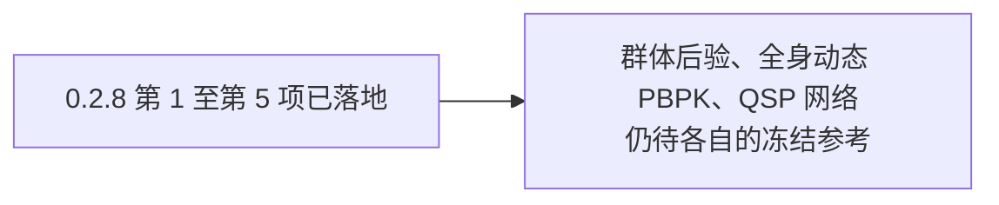

# 0.2.6 之后的实现计划

> **文档版本**：v1.2  
> **更新日期**：2026-11-11  
> **适用代码**：PharmacoWeave 0.2.9  
> **代码状态**：第 1 至第 5 项已落地。三室研究拟合在 0.2.9 报告标准误和置信区间。`run_in_process` 仍拒绝进程内 FOCE、SAEM、MCMC、全身动态 PBPK 和 QSP 网络。

0.2.6 已经完成两阶段对数参数汇总、显式生理表、线性周转闭式解、肝加一个组织的代数稳态，以及调用方群体结果表。标准误目前只随个体估计保存。线性周转模型 `dR/dt = kin − kout·R` 已经有冻结参考。本文只排这两项前置已经存在的后续工作，以及更靠后的接线和三室模型。

## 1. 总原则

1. 新公开函数先有失败用例，再有一份不导入本包算出的数值参考，然后才实现。上一项的测试未写进仓库之前，下一项不进入公开函数。
2. 加权汇总是描述性汇总。它不重新拟合，不产生群体后验，也不是 FOCE、SAEM 或 MCMC。
3. 间接反应和效应滞后各写一条由调用方给参数的闭式解。证据等级是 `predicted`。函数不估计参数，不读取给药方案，也不求解网络。
4. 血管外参数写 `CL/F`、`V/F`。静脉参数写 `CL`、`V`。绝对参数和表观参数不能放进同一次汇总。
5. 命令行和结果包只转写已经验收的记录，不改变公式。
6. 临床给药建议、隐式物种生理表、SEND 和 21 CFR Part 11 保持拒绝。nlmixr2、PK-Sim、MoBi 和 NONMEM 不进入依赖，也不按名字启动。

## 2. 实施顺序

| 顺序 | 模块 | 要做的事 | 验收 | 这一项明确不做 |
|---|---|---|---|---|
| 1 | `population_pk` | 用标准误对已有个体估计做对数尺度加权几何均值和加权样本方差 | `s/theta` 相同的 0.05 与 0.20 L/h 仍得到几何均值 0.10 L/h。三名受试者的不等标准误对照下文手算，相对误差不超过 1e-12 | 不改 0.2.6 的不加权函数。不跑群体后验 |
| 2 | `qsp` | 恒定抑制下的线性周转闭式解，证据等级 `predicted` | 抑制分数为 0 时与 `simulate_linear_turnover` 的相对误差不超过 1e-12。下文的 `I = 0.5` 参考同样不超过 1e-12 | 不估计参数，不连接剂量，不求解带反馈的网络 |
| 3 | `pd_models` | 效应室 `dCe/dt = ke0·(C − Ce)`。`C` 使用已经验收的一室静脉推注闭式解 | `Ce(0) = 0`。下文 `t = ln 2` 的手算相对误差不超过 1e-12。`ke0 = kel` 的极限形式单独有一条参考 | 不估计 `ke0`，不把效应室浓度写成实测浓度 |
| 4 | 命令行与结果包 | 为已经验收的记录增加调用入口，并把记录写入结果包 | 落盘 JSON 与对应 Schema 一致。数值与直接调用函数的相对误差不超过 1e-12 | 不新增公式，不解释引擎槽响应 |
| 5 | `pk_models` | 三室静脉推注先写出闭式解，再用无噪声曲线做参数回收 | `C(0) = Dose/V1`，`AUC∞ = Dose/CL`。回收相对误差在参考文件里写明 | 在闭式解和回收基准写入测试之前，不提供拟合函数 |

第 1 项已在 0.2.7 落地。第 2 至第 5 项已在 0.2.8 落地。0.2.9 把三室接到 `pharmacoweave fit --model three_compartment_iv_bolus`，并报告标准误和 95% 置信区间。第 8 节的重型算法仍然拒绝。

## 3. 第一项：加权两阶段

`summarize_weighted_log_parameters` 已在 0.2.7 实现。输入沿用 `IndividualParameterEstimate`。输入沿用 `IndividualParameterEstimate`。标准误和点估计使用同一单位，先换到该参数的约定单位，再进入权重。`CL` 与 `CL/F` 的约定单位是 L/h，`V` 与 `V/F` 是 L。

设约定单位下的点估计为 `theta`，标准误为 `s`：

- `u = ln theta`
- `w = 1 / (s / theta)^2`
- 加权对数均值 `m = Σ(w·u) / Σw`
- 几何均值是 `exp(m)`
- 记 `V1 = Σw`，`V2 = Σ(w^2)`。加权对数方差是 `Σ(w·(u − m)^2) / (V1 − V2/V1)`

`s / theta` 全部相同且为正时，权重相同，方差等于 0.2.6 的样本方差，分母仍是人数减 1。绝对标准误相同而点估计不同时，权重并不相同，几何均值也不再是不加权结果。两名受试者时，加权方差恒等于 `(ln theta_1 − ln theta_2)^2 / 2`，所以两名受试者只能检验几何均值是否随权重移动。区分加权方差公式的参考使用三名受试者。

失败时不输出任何均值：

- 同一参数组同时出现 `CL` 和 `CL/F`，或同时出现 `V` 和 `V/F`。
- 人数小于 2，受试者标识重复，点估计缺失、非正或单位不能换到约定单位。
- 任一标准误缺失、非正或非有限。权重不能形成时，不丢弃该受试者，也不退回不加权均值。

局限性写明：这是已有个体估计的加权描述，本函数没有重新拟合，也没有产生群体后验。

手算参考放在 `tests/regression/`，不由本包生成。

- 相对标准误相同：0.05 L/h 配标准误 0.005 L/h，0.20 L/h 配 0.02 L/h。几何均值 0.10 L/h。对数方差 `2·(ln 2)^2`。
- 标准误不同：0.05 L/h 配标准误 0.05 L/h，0.10 L/h 配 0.10 L/h，0.20 L/h 配 0.10 L/h。权重是 1、1、4。几何均值是 `0.1·√2`。对数方差是 `(7/6)·(ln 2)^2`。

## 4. 第二项：恒定抑制的周转模型

计划中的函数名是 `simulate_constant_inhibition_turnover`。调用方给出 `kin`、`kout`、`R0`、抑制分数 `I`、时间网格和 `context_of_use`。

`dR/dt = kin·(1 − I) − kout·R`

`R(t) = R0·e^{−kout·t} + (kin·(1 − I)/kout)·(1 − e^{−kout·t})`

稳态是 `kin·(1 − I)/kout`。`I = 0` 时，每个时间点和稳态都与 `simulate_linear_turnover` 一致。

手算参考：`kin = 2`，`kout = 1`，`R0 = 0`，`I = 0.5`。稳态是 1。`R(0) = 0`。`R(ln 2) = 0.5`。

拒绝：`kin` 或 `kout` 非正，`R0` 为负，`I` 不在 `[0, 1)`，时间不严格递增，或 `estimate_parameters=True`。`I = 1` 使生成项为 0，也拒绝。曲线不读取剂量，也不连接临床终点。

## 5. 第三项：效应室

第二项的测试写进仓库之后再实现。计划中的函数名是 `simulate_effect_compartment`。血浆浓度使用已经验收的一室静脉推注闭式解，`Ce(0) = 0`。

`kel = CL/V`，`C(t) = (Dose/V)·e^{−kel·t}`。

`ke0 ≠ kel` 时：

`Ce(t) = (Dose/V)·ke0/(ke0 − kel)·(e^{−kel·t} − e^{−ke0·t})`

`ke0 = kel` 时：

`Ce(t) = (Dose/V)·kel·t·e^{−kel·t}`

手算参考：`Dose = 1 mg`，`V = 1 L`，`kel = 1 h⁻¹`，`ke0 = 2 h⁻¹`。`Ce(0) = 0`。`Ce(ln 2) = 0.5 mg/L`。`ke0 = kel = 1 h⁻¹` 时，`Ce(1) = 1/e mg/L`，作为极限形式的单独参考。证据等级是 `predicted`。`ke0` 非正、剂量或体积非正，或要求估计参数时拒绝。

## 6. 第四项：命令行与结果包

0.2.6 的五项函数，以及本文件中已经落地的函数，可以接成命令并写入结果包。接线前公式和 Schema 已经存在。结果包中的 JSON 使用这些 Schema，数值与直接调用函数一致。读群体结果表的路径仍不创建子进程。引擎槽响应继续按原文保存，不自动提升为估计。

## 7. 第五项：三室

三室排在前四项之后。先把静脉推注闭式解和一条无噪声参数回收参考写入 `tests/regression/`，并核对 `C(0) = Dose/V1` 与 `AUC∞ = Dose/CL`。拟合函数只在这份参考和失败用例存在之后添加。拟合失败时不输出清除率。

## 8. 仍不排进本计划

下列事项保持拒绝，直到各自另有冻结参考和失败测试：

- 进程内 FOCE、Laplace、SAEM、MCMC 和群体后验。
- 由稀疏或破坏性采样直接估计群体参数。
- 剂量或间隔不相等的 NCA 与模拟。
- 全身多器官动态 PBPK，以及按物种名填充的生理默认值。
- 带反馈、多个时滞或 SBML 的 QSP 网络。MoBi 不进入依赖。
- 把 `parameter_correlation`、两阶段几何均值或 IVIVE 预测写成实测清除率。
- 把引擎槽响应自动提升为估计。
- 临床给药建议、首次人体剂量、SEND 导出和 21 CFR Part 11 声明。
- 把 nlmixr2、PK-Sim、MoBi 或 NONMEM 写入依赖或按这些名字启动。

## 9. 和现有文档的关系

已完成范围以 `docs/roadmap.md` 为准。0.2.6 五项函数的原计划和拒绝清单留在 `docs/phase4-population-pbpk-qsp.md`。本文只给 0.2.6 之后的进入顺序，不改变当前代码。
