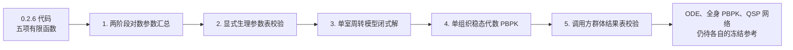

# 群体模型、PBPK 与 QSP 的实现计划

> **文档版本**：v1.1  
> **更新日期**：2026-11-10  
> **适用代码**：PharmacoWeave 0.2.6  
> **代码状态**：第 1 至第 5 项已在 0.2.6 落地。`run_in_process` 仍拒绝进程内 FOCE、SAEM、MCMC、全身动态 PBPK 和 QSP 网络。

立项 Phase 4 原文要求接入经过验证的群体药代、生理药代和定量系统药理学引擎。0.2.5 没有实现这三项计算。0.2.6 落地下面第 1 至第 5 项。更早已经落地的相关能力是：个体解析模拟、调用方给出的对数参数相关、显式生理假设的 Well-Stirred IVIVE，以及调用方进程外引擎槽。nlmixr2 与 PK-Sim 只登记许可证。

## 1. 总原则

1. 新公开函数先有失败用例，再有一份不导入本包算出的数值参考，然后才实现。
2. 进程内不估计群体后验，不求解全身 PBPK 微分方程，不求解 QSP 网络。
3. nlmixr2、PK-Sim、MoBi 和 NONMEM 不进入依赖，也不由包名启动。调用方自备的可执行文件仍走 0.2.5 的引擎槽：文件、版本和许可证文本缺一则不创建子进程，响应原文保存。
4. 血管外参数写 `CL/F`、`V/F`。静脉参数写 `CL`、`V`。两类参数不能放进同一次汇总。
5. 生理数字由调用方逐项给出，并带来源说明。核心库不放物种默认表。
6. 预测结果的证据等级是 `predicted`。两阶段汇总只汇总已经存在的个体估计，并写明它不是 NLME 后验。
7. 临床给药建议、首次人体剂量和监管符合性声明保持拒绝。
8. `parameter_correlation` 继续只作用于解析模拟的对数参数扰动。它不是群体清除率。

## 2. 实施顺序

| 顺序 | 模块 | 公开函数要做的事 | 验收 | 这一项明确不做 |
|---|---|---|---|---|
| 1 | `population_pk` | 对调用方已有的个体 `CL` 与 `V`，或个体 `CL/F` 与 `V/F`，计算对数尺度的几何均值和方差 | 两名受试者清除率 0.05 与 0.20 L/h 时，几何均值为 0.10 L/h。手算相对误差不超过 1e-12。混合绝对参数和表观参数、少于两名受试者、非正参数时拒绝 | 不跑 FOCE、SAEM 或 MCMC。不把结果写成群体后验 |
| 2 | `pbpk` | 校验一份调用方给全的生理参数表：体重、组织体积、血流量、组织分配系数和来源说明 | 流量总和不等于心输出量、体积非正、缺来源说明时拒绝。通过校验也不产生浓度 | 不查物种表，不求解组织微分方程 |
| 3 | `qsp` | 一个线性周转模型 `dR/dt = kin - kout·R` 的闭式解，证据等级 `predicted` | `R(0)=0` 时 `R(t)= (kin/kout)·(1-e^{-kout·t})`，稳态为 `kin/kout`。相对误差不超过 1e-12。`kin` 或 `kout` 非正时拒绝 | 不估计参数，不给出给药方案，不求解网络 |
| 4 | `pbpk` | 在已校验的生理表上，计算肝加一个组织的稳态代数浓度。每个生理数字仍由调用方给出 | 一份十进制冻结参考。输出为 `predicted`，局限性写明生理数字是假设 | 不做全身多器官动态模拟，不启动 PK-Sim |
| 5 | `population_pk` | 读入调用方已经跑完的群体结果表，核对列、参数名、受试者标识和证据等级 | 缺列、把 `CL/F` 标成 `CL`、或把预测标成实测时拒绝。读入过程不创建子进程 | 不根据表反推 nlmixr2 控制流，不把引擎槽响应自动提升为估计 |

这五项的失败用例和数值参考已经写进 `tests/numerical_benchmarks/test_phase4_planned_slices.py`，公开函数已在 0.2.6 落地。`run_in_process` 仍然拒绝。

## 3. 群体模型

### 3.1 现在已经有的基础

个体一室和二室拟合可以给出带标准误的 `CL`、`V` 或 `CL/F`、`V/F`。解析模拟可以在对数参数上使用调用方提供的相关矩阵。相关矩阵生成的是预测带，局限性已经写明它不是群体模型。

### 3.2 第一项：两阶段汇总

输入是每个受试者一条已经完成的个体估计，至少包含受试者标识、参数名、点估计和单位。函数按参数名分组。

计算写在对数尺度上：

- 几何均值是 `exp(平均 ln 参数)`。
- 对数方差是 `ln 参数` 的样本方差。受试者人数小于 2 时不计算方差，并拒绝整次汇总。
- 标准误可以随行保存，但不参与第一项的加权。加权两阶段留到单独的冻结参考之后。

失败时不输出均值：

- 同一参数组里同时出现 `CL` 和 `CL/F`，或同时出现 `V` 和 `V/F`。
- 点估计缺失、非正或单位不能换到该参数的约定单位。
- 受试者标识重复。
- 人数小于 2。

结果记录人数、参数名、几何均值、对数方差、单位和局限性。局限性写明：这是个体估计的描述汇总，估计方法是调用方原来的个体拟合，本函数没有重新拟合，也没有产生群体后验。

手算参考放在 `tests/regression/`，用十进制写出，不由本包生成。建议锁定：0.05 与 0.20 的几何均值为 0.10；对数方差为 `[(ln 0.05-ln 0.10)^2 + (ln 0.20-ln 0.10)^2] / 1`。分母用人数减 1。相对误差上限 1e-12。

### 3.3 第五项：调用方群体结果表

群体估计若来自外部程序，程序由调用方自己准备。PharmacoWeave 只在 0.2.5 引擎槽的规则下记录可执行文件、版本、许可证文本和哈希。第五项另外接受一张已经落盘的结果表，列至少包括参数名、点估计、单位、估计方法和证据等级。

读入规则：

- 证据等级只接受调用方声明的 `estimated` 或 `predicted`，并原样保留。
- `CL` 与 `CL/F` 分列。
- 表内不出现给药建议字段。出现时整表拒绝。
- 读表不调用 `subprocess`。

### 3.4 继续留在计划外的群体算法

FOCE、Laplace、SAEM、MCMC、个体间相关矩阵的联合估计、从稀疏采样直接做群体模型，都还没有本包的冻结参考。在那份参考和失败用例写入测试之前，不增加对应公开函数。稀疏采样本身也仍在血浆 NCA 的拒绝范围内。

## 4. PBPK

### 4.1 现在已经有的基础

`PhysiologicalScalingParams` 要求调用方给出体重、肝重、肝血流，以及 MPPGL 或肝细胞密度中本次 IVIVE 需要的那一项，并写来源。Well-Stirred 肝清除预测的证据等级是 `predicted`。`human_starting_dose_from_ivive` 拒绝。

### 4.2 第二项：生理参数表

新记录保存调用方给出的心输出量、各组织体积、各组织血流量、各组织分配系数和来源说明。组织名单由这次请求显式列出。未列出的组织不补零，也不从物种名查表。

校验：

- 每个体积、流量和分配系数为正，并带单位。
- 组织血流量之和与声明的心输出量一致，相对容差写进该函数的测试。
- 每条数字都有来源说明。
- 校验成功的返回值只有参数表和校验结论，没有浓度、AUC 或清除率。

### 4.3 第四项：肝加一个组织的稳态代数解

在第二项的表上，只允许肝和一个额外组织。速率方程用代数稳态，不用时间步进。组织浓度由调用方给出的分配系数、流量和肝清除参数写出。公式和十进制参考一起冻结，参考文件不导入本包。

输出：

- 证据等级 `predicted`。
- 局限性列出每一项生理假设的来源标识。
- 不报告给药剂量建议。
- 参数名保持静脉 `CL` 或血管外 `CL/F` 中调用方声明的那一种。

组织数大于 2、缺少分配系数、或要求输出时间曲线时，函数拒绝。全身动态 PBPK 仍使用 `run_in_process` 拒绝。

### 4.4 PK-Sim

PK-Sim 继续只出现在引擎目录中，许可证记为 GPL-2.0-only，`executable` 为 false。调用方若自行持有可执行文件，只能通过引擎槽启动，并自行提供许可证文本。第五项的结果表已经可以单独读入，但引擎槽响应仍按原文保存，不会自动提升为估计。

## 5. QSP

### 5.1 现在的边界

`simulate_linear_turnover` 已在 0.2.6 落地。`qsp.run_in_process` 仍拒绝网络。直接效应和 Sigmoid Emax 只描述浓度到效应的静态关系。效应滞后和间接反应还没有自己的冻结参考，因此还没有拟合函数。

### 5.2 第三项：线性周转模型

状态方程：

`dR/dt = kin - kout·R`

初值 `R(0)=R0` 时，闭式解为：

`R(t) = R0·e^{-kout·t} + (kin/kout)·(1-e^{-kout·t})`

稳态为 `kin/kout`。第一份参考把 `R0` 定为 0，`kin` 与 `kout` 用十进制正数，核对若干时间点和稳态。相对误差不超过 1e-12。

函数输入是 `kin`、`kout`、`R0`、时间网格和 `context_of_use`。输出曲线的证据等级是 `predicted`。`kin` 或 `kout` 非正、时间非增、或调用方要求估计这些参数时拒绝。

这个模型是后面任何间接反应或网络模型的前置基准。它本身不读取剂量，也不连接临床终点。

### 5.3 网络与外部系统药理模型

多个状态、时滞、反馈、SBML 或 MoBi 模型，在周转模型的参考测试存在之后才单独开题。每一类模型单独准备失败用例和数值参考。MoBi 不进入依赖。调用方自备的可执行文件仍受引擎槽规则约束。

## 6. 三项共用的拒绝清单

下列行为在第 1 至第 5 项全部落地之后仍然拒绝，直到它们各自拥有冻结参考和失败测试：

- 进程内 FOCE、SAEM、MCMC 和群体后验采样。
- 由稀疏或破坏性采样直接估计群体参数。
- 全身多器官动态 PBPK，以及任何按物种名填充的生理默认值。
- 带反馈或时滞的 QSP 网络。
- 把 `parameter_correlation`、两阶段几何均值或 IVIVE 预测写成实测清除率。
- 临床给药建议、首次人体剂量、SEND 导出和 21 CFR Part 11 声明。
- 把 nlmixr2、PK-Sim、MoBi 或 NONMEM 写入依赖或按这些名字启动。

## 7. 和现有文档的关系

已完成范围以 `docs/roadmap.md` 为准。立项原文的 Phase 4 措辞保留在 `docs/development-plan.md`。可行性收窄保留在 `docs/feasibility.md`。第 1 至第 5 项已在 0.2.6 落地。`run_in_process` 仍拒绝第 6 节列出的重型算法。
