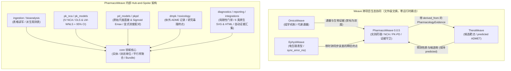
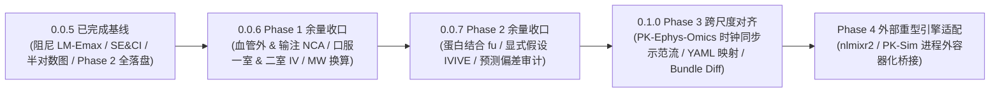

# PharmacoWeave 项目设计评估与下一阶段实施方案

> **文档版本**：v2.1  
> **更新日期**：2026-10-30  
> **适用版本**：PharmacoWeave 0.0.5 (Pre-Alpha)  
> **演进记录**：v1.0 基于 `0.0.1` 撰写；v2.0 升级至 `0.0.4` 基线；本文 v2.1 升级至 `0.0.5` 基线，记录统计加固（原始效应尺度阻尼 LM Emax / Sigmoid Hill、渐近标准误与 95% 置信区间）、半对数/加权残差/浓度–效应诊断 SVG、可审计 BLQ 派生与平行样聚合，以及 Phase 2 全链路 Bundle 落盘与 8 份 JSON Schema 同步的完成情况，并衔接后续 `0.0.6`–`0.1.0` 路线。

---

## 一、 评估概述与核心结论

PharmacoWeave 定位为**面向定量药理学研究的数据模型与验证工具包（Research-use Quantitative Pharmacology Toolkit）**，旨在解决定量药理学实验数据孤岛、跨项目证据边界混乱、单位量纲失真、BLQ（低于定量限）处理不规范以及缺乏可复现审计追踪等核心痛点。

### 综合评估结论（0.0.5 基线）

1. **设计合理性：优秀（科学严谨度高，认识论护栏与轻量工程高度统一）**  
   项目坚持“Research Use Only”定位、采用单向依赖的 Hub-and-Spoke 拓扑、构建封闭单位量纲词表、严格执行清除率语义隔离（`CL` vs `CL/F`）与 BLQ 不可变审计，并建立了 5 级跨项目证据守卫。`0.0.2`–`0.0.5` 在不引入 `scipy`、`matplotlib` 或任何 copyleft 外部包的前提下，用标准库纯 Python 实现了带阻尼 Levenberg–Marquardt 的 PK/PD 非线性最小二乘、$J^T W J$ 渐近不确定度推断和 6 类原生矢量 SVG 诊断图。
2. **实现情况：`0.0.5` 圆满收口 Phase 2 全链路与统计加固**  
   `0.0.4` 识别出的 Phase 2 内存孤岛、双倒数线性化噪声脆弱性、参数缺少标准误/置信区间、缺少半对数与加权残差图、CLI 隐式耦合及平行样/派生表断层已在 `0.0.5` 全部闭环解决。
3. **下一步演进主线清晰**  
   后续路线按科学验收切片推进：**`0.0.6`（血管外给药、恒速输注与二室模型，Phase 1 余量收口）** → **`0.0.7`（蛋白结合、显式假设研究级 IVIVE 与预测偏差审计，Phase 2 余量收口）** → **`0.1.0`（Phase 3 组学/电生理时序对齐与工程工具链）** → **Phase 4（外部 PopPK/PBPK 进程外适配器）**。

---

## 二、 设计的合理性评估

### 2.1 `0.0.5` 已闭环消除的四项技术缺口
1. **升级原始尺度阻尼 LM Emax / Sigmoid Hill 求解器**：在 `pd_models/emax.py` 与 `core/numerics.py` 中提供原尺度多起点阻尼 Levenberg–Marquardt 求解器，支持带噪低浓度跨越基线波动与可选 `hill` 系数估计，并对缺少平台期/过渡区或曲率退化曲线严格拒算。
2. **补齐 PK/PD 渐近标准误与 95% 置信区间**：为 `ParameterEstimate`（`CL`、`V`）与 `EffectParameter`（`Emax`、`EC50`、`hill`）导出基于 $(J^T W J)^{-1}$、Student-$t$ 分布与正参数对数尺度 Delta 法则的 `standard_error` 与 95% CI。
3. **补齐原生诊断 SVG 并解耦 CLI**：新增半对数浓度–时间图（含 LLOQ 线、拟合叠加曲线与终末相选点标记）、加权相对残差图和浓度–效应曲线图；`pharmacoweave nca --bundle` 默认纯 NCA（通过 `--with-fit` 显式开启拟合），并新增 `pharmacoweave emax` 子命令。
4. **打通 Phase 2 结果包落盘、8 份 JSON Schema 与派生/平行样管线**：结果包持久化 `derived_observations.parquet`、`emax_parameters.parquet`、`emax_predictions.parquet`、`in_vitro_adme.parquet`、`tox_endpoints.parquet`，并自动汇集核验 `pharmacology_evidence.json`；`core/profiles.py` 提供 `collapse_replicates()` 算术/几何均值聚合与 CV% 统计。

### 2.2 面向 `0.0.6+` 的后续待拓展边界
1. **PK 试验设计扩展（`0.0.6`）**：开放单次血管外给药（`oral`/`sc`）与静脉恒速输注（`iv_infusion`）NCA、一室血管外吸收拟合、二室静脉推注拟合及显式分子量支撑的质量–摩尔浓度换算。
2. **体外结合率、研究级显式 IVIVE 与预测审计（`0.0.7`）**：开放 `fu_plasma`、`fu_mic`、`blood_to_plasma_ratio`、显式生理参数探索性 `predicted` IVIVE 及 Fold Error / AAFE / AFE 校准审计。
3. **研究目录观测桥接与跨尺度时序对齐（`0.1.0`）**：打通研究目录 `observations` 向 `EffectObservation` 的桥接，交付 `EphysWeave` / `OmicsWeave` 跨时间基准对齐示范流、`ingest_mapping.yaml` 映射以及 `verify-bundle` / `diff` 工具。

---

## 三、 后续分阶段实施路线（`0.0.6` → `0.1.0` 及 Phase 4）

各后续里程碑的详细验收切片见 `docs/roadmap.md`。
