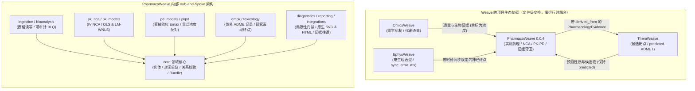
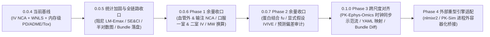

# PharmacoWeave 项目设计评估与下一阶段实施方案

> **文档版本**：v2.0  
> **更新日期**：2026-10-30  
> **适用版本**：PharmacoWeave 0.0.4 (Pre-Alpha, commit `8ad0585`)  
> **演进记录**：v1.0 基于 `0.0.1`（commit `02240d9`）撰写；本文升级至 `0.0.4` 基线，覆盖 `0.0.2`（单次静脉推注 NCA 与对数线性拟合）、`0.0.3`（阻尼 LM 加权非线性拟合、残差诊断图与 50 位十进制冻结参考）及 `0.0.4`（直接效应 Emax、体外 ADME、毒理终点与证据往返）的实现评估与后续 `0.0.5`–`0.1.0` 路线规划。分阶段验收口径与 `docs/roadmap.md` 保持一致。

---

## 一、 评估概述与核心结论

PharmacoWeave 定位为**面向定量药理学研究的数据模型与验证工具包（Research-use Quantitative Pharmacology Toolkit）**，旨在解决定量药理学实验数据孤岛、跨项目证据边界混乱、单位量纲失真、BLQ（低于定量限）处理不规范以及缺乏可复现审计追踪等核心痛点。

### 综合评估结论（0.0.4 基线）

1. **设计合理性：优秀（科学严谨度高，认识论护栏与轻量工程高度统一）**  
   项目坚持“Research Use Only”定位、采用单向依赖的 Hub-and-Spoke 拓扑、构建封闭单位量纲词表、严格执行清除率语义隔离（`CL` vs `CL/F`）与 BLQ 不可变审计，并建立了 5 级跨项目证据守卫。尤为突出的是，`0.0.2`–`0.0.4` 在不引入 `scipy`、`matplotlib` 或任何 copyleft 外部包的前提下，用标准库纯 Python 实现了带阻尼 Levenberg–Marquardt 的加权非线性最小二乘（WNLS）和原生矢量 SVG 诊断图，保持了核心分发包的极简与零许可证污染。
2. **实现情况：跨越式推进（单次 IV 闭环跑通，Phase 2 核心契约激活，全链路收口待完成）**  
   代码规模已扩展至 `src/pharmacoweave/` 下 **56 个源文件**、`tests/` 下 **21 个测试文件**。16 个子包中已有 **4 个 `available`**、**8 个 `partial`**、仅余 **4 个重型模块 `reserved`**。单次静脉推注从读表、NCA、加权拟合、诊断图到 `ResultBundle` 导出已端到端闭环；`pd_models`、`pkpd`、`dmpk`、`toxicology` 与 `PharmacologyEvidence` 已完成内存级契约与核心计算验证。
3. **文件安排与仓库治理：早期冗余已全部清理，当前重点转向契约落盘一致性**  
   `0.0.1` 时期存在的 `.idea/` 未忽略、重复规划文件、`docs/arch_design/` 空目录及 `tests/regression/` 空置问题均已在 `#4`–`#5` 提交中彻底解决。当前主要结构缺口在于：`0.0.4` 新增的 Phase 2 模型尚未接入 `ingestion/`、`core/bundle.py`、`schemas/` 导出清单与 `cli.py` 入口。
4. **下一步演进主线清晰**  
   后续路线按科学验收切片推进：**`0.0.5`（统计加固与 Phase 2 全链路落盘收口）** → **`0.0.6`（血管外给药、恒速输注与二室模型）** → **`0.0.7`（蛋白结合、显式假设研究级 IVIVE 与预测偏差审计）** → **`0.1.0`（Phase 3 组学/电生理时序对齐与工程工具链）** → **Phase 4（外部 PopPK/PBPK 进程外适配器）**。

---

## 二、 设计的合理性评估

### 2.1 架构边界与定位的合理性
- **明晰的克制定位（Research Use Only）**：  
  在 `docs/feasibility.md` 及毒理、拟合输出模型中强制写入研究用途声明与局限性（`limitations`），明确拒绝生成临床给药建议或冒充 GxP / CDISC SEND / 21 CFR Part 11 合规申报系统。
- **零重型依赖与许可证隔离**：  
  坚持“不重写 NONMEM / PK-Sim，也不把 copyleft 引擎引进运行时 `import` 图”。基础数值计算采用标准库数学原语加上手写十进制独立回归参考（`iv_bolus_quiet_nca.json`），重型群体与生理药代引擎留待 Phase 4 通过独立子进程适配。
- **单向依赖拓扑（Hub-and-Spoke）**：  
  所有分析与集成子包单向依赖 `core`，`core` 不反向依赖任何算法包；跨 Weave 仓库交互严格通过带 SHA-256 与 Schema 版本号的 JSON/Parquet 文件完成。

### 2.2 领域数据模型的科学严谨性
- **受试者为唯一统计单元**：`Subject` 独立建模，平行测定通过 `replicate_id` 标识，防止将技术复孔误算为生物学样本量。
- **动力学与效应量纲强隔离**：  
  - 静脉给药报告 `CL`、`V`；未知生物利用度 `F` 的血管外给药强制报告 `CL/F`、`V/F`；
  - 体外 ADME 仅接受微粒体/肝细胞本征清除率或膜通透性单位（如 `uL/min/mg_protein`、`cm/s`），显式拒绝体内清除率单位 `L/h`；
  - `pkpd` 仅允许将直接效应与显式浓度观测（`ExposureKind.CONCENTRATION`）配对，拒绝把暴露汇总指标 `AUC` 或 `Cmax` 塞入瞬时浓度 Emax 方程。
- **BLQ 零容忍数值污染**：BLQ、高于 ULOQ、缺失和无效记录严禁填写 `numeric_value`；所有浓度图与残差图均自动跳过删失点，绝不把 BLQ 画成 0。
- **认识论证据分级锁死**：5 级 `evidence_type`（`observed`、`estimated`、`predicted`、`literature`、`hypothesis`）贯穿始终。`PredictedEffect` 固定为 `predicted`；外部预测 ADMET 经过 `PharmacologyEvidence` 往返序列化后仍保持 `predicted`，不会因进入药理库而被“洗白”为实测值。

### 2.3 当前（0.0.4）识别出的六项关键技术缺口
1. **Phase 2 新模型处于“内存孤岛”状态**：`EffectObservation`、`DirectEmaxFit`、`InVitroAdmeRecord`、`ToxEndpoint` 仅有 Python 内存构造器，尚未打通 `ingestion/tabular.py` 读表、`core/bundle.py` Parquet 落盘、`schema_export.py` Schema 导出以及 `cli.py` 子命令；`bundle.py` 中的 `pharmacology_evidence.json` 目前仅写出外部挂载证据，未导出本轮新生成的 `PharmacologyEvidence`。
2. **直接效应 Emax 采用双倒数线性化存在统计脆弱性**：`pd_models/emax.py` 当前通过对 `1/(E - E0)` 与 `1/C` 做普通最小二乘回归（Lineweaver–Burk 变换）求解 `Emax` 和 `EC50`。该变换会极度放大低浓度微弱效应点的随机误差，且一旦带噪数据中有任意单点因测量波动跨越基线 `E0` 就会直接拒算，亟需升级为原始效应空间的阻尼非线性最小二乘求解器。
3. **参数估计缺少标准误/置信区间，诊断图缺少半对数与加权残差视角**：`pk_models/wnls.py` 在收敛点已算出加权雅可比信息矩阵 $J^T W J$，但尚未向 `ParameterEstimate` 导出 `standard_error`、`ci_lower`、`ci_upper`；`reporting/figures.py` 目前仅有线性轴浓度–时间图与未加权残差图，缺少药代动力学核心的**半对数（Semi-log）浓度–时间图**和**加权/相对残差图**。
4. **CLI 与派生数据管线存在局部耦合与断层**：`pharmacoweave nca --bundle` 内部隐式调用了 `fit_iv_bolus`，将非室分析与一室参数拟合强绑在一起；同时 `core/profiles.py` 尚未串联 `bioanalysis/qc.py` 的可审计 BLQ 派生表以及 `replicate_id` 平行样聚合辅助函数。
5. **PK 试验设计仍锁死在单次静脉推注**：研究实体与 `core/modeling.py` 已定义 `CL/F`、`Vz/F`、`ka` 等契约，但口服/皮下等血管外给药、静脉恒速输注、二室静脉推注以及显式分子量（`molecular_weight`）支撑的质量–摩尔浓度换算尚未开放计算。
6. **研究目录观测与跨项目时序对齐尚未合龙**：`PharmacologyStudy.observations` 中 `observation_type="effect"` 的行尚无桥接函数转换为 `pkpd` 所需的 `EffectObservation`，距离 `EphysWeave` / `OmicsWeave` 跨时间基准对齐示范流还差最后一层胶水代码。

---

## 三、 目前的实现情况评估（0.0.4 基线）

### 3.1 各功能模块实现深度矩阵（16 个子包）

| 模块名称 | 源码路径 | 阶段状态 | 实现深度与 `0.0.4` 能力详述 | 待补齐缺口 |
| :--- | :--- | :---: | :--- | :--- |
| **`core`** | `src/pharmacoweave/core/` | `available` | 实体契约、5 维封闭单位 + 无量纲效应单位、500+ 行跨表校验、`profiles.py` 浓度曲线提取、`bundle.py` SHA-256 结果包导出全功能运转。 | 串联 `bioanalysis.qc` 派生层；增加 `collapse_replicates()`；在 Bundle 中落盘 Phase 2 分析表与新生成证据。 |
| **`ingestion`** | `src/pharmacoweave/ingestion/` | `available` | `tabular.py` 完整支持研究目录 CSV / TSV / Parquet 的双向读写与列顺序强校验。 | 支持 Phase 2 扩展表导入及声明式 `ingest_mapping.yaml` 原始仪器表列映射。 |
| **`bioanalysis`** | `src/pharmacoweave/bioanalysis/` | `available` | `qc.py` 实现 5 种不可变、保留审计列的 BLQ 处理策略。 | 将派生后的 `AnalysisObservation` 正式接入分析主链路并落盘 Parquet。 |
| **`pk_nca`** | `src/pharmacoweave/pk_nca/` | `available` | 单次静脉推注连续采血 NCA：`linear_up_log_down`、`C0` 对数反推、`pharmacoweave.lambda_z.adjusted_r2.v1` 自动终末相选点、外推比门控。 | 扩展单次血管外给药（`oral`/`sc`）与静脉恒速输注（`iv_infusion`）NCA。 |
| **`pk_models`** | `src/pharmacoweave/pk_models/` | `partial` | 一室静脉推注解析解、`fit_iv.py` 对数线性回归、`wnls.py` 纯 Python 阻尼 LM 加权非线性拟合（`1/y`、`1/y^2`）及海森曲率比可辨识性诊断。 | 导出参数 `standard_error` / `CI`；新增一室血管外吸收拟合与二室静脉推注拟合。 |
| **`diagnostics`** | `src/pharmacoweave/diagnostics/` | `partial` | 强制要求通过诊断时附带非空 `limitations`；支持拟合残差与可辨识性失败记录。 | 增加先验预测 vs 后验实测偏差校准（Fold Error / AAFE / AFE）诊断器。 |
| **`reporting`** | `src/pharmacoweave/reporting/` | `partial` | Jinja2 HTML 报告 + 原生无依赖 SVG（线性浓度–时间图、观测值–预测值图、残差–时间图），BLQ 自动剔除不画 0。 | 新增半对数浓度–时间图（含 LLOQ 与拟合线）、加权残差图及浓度–效应 Emax 图。 |
| **`integrations`** | `src/pharmacoweave/integrations/` | `partial` | 跨项目证据防篡改守卫（`guards.py`）+ 带 `derived_from` 的 `PharmacologyEvidence` 生成与 JSON 往返校验。 | 接入 `ResultBundle` 自动导出；补充外部 CADD 预测表导入桥接。 |
| **`pd_models`** | `src/pharmacoweave/pd_models/` | `partial` | `EffectObservation`（3 类时间尺度、5 类量纲）、`PredictedEffect`（锁死 `predicted`）及基线固定、`hill=1` 的直接效应 Emax 拟合。 | 替换为原始空间阻尼 LM 非线性求解器以抗噪声；支持可选 Sigmoid `hill` 系数与 `SE`/`CI`。 |
| **`pkpd`** | `src/pharmacoweave/pkpd/` | `partial` | `link.py` 将直接效应与显式浓度记录配对并执行量纲归一化，拒绝 `AUC`/`Cmax` 误充瞬时浓度。 | 建立从 `PharmacologyStudy.observations` 加上 `timebase_id`/`sync_error_ms` 的自动配对桥。 |
| **`dmpk`** | `src/pharmacoweave/dmpk/` | `partial` | `InVitroAdmeRecord` 校验膜通透性、微粒体与肝细胞本征清除率记录，拒绝 `L/h` 混入，显式拦截无假设体内外推。 | 补充 `fu_plasma`、`fu_mic`、`blood_to_plasma_ratio` 及显式生理参数下的研究级 `predicted` IVIVE。 |
| **`toxicology`** | `src/pharmacoweave/toxicology/` | `partial` | `ToxEndpoint` 强制关联 `dose_event_id` 或 `exposure_ref`，校验发生率分母与研究用途局限性，拒绝生成临床剂量。 | 支持从研究表批量构建并写入 `ResultBundle` 汇总制品。 |
| **`population_pk` / `pbpk` / `qsp` / `simulation`** | 各同名目录 | `reserved` | 暴露模块状态契约，安全拦截未实现的重型分析调用。 | Phase 4 通过独立子进程与文件交换协议适配 `nlmixr2`、`PK-Sim / MoBi` 等外部引擎。 |

### 3.2 自动化测试与数值基准覆盖情况
- **五维测试矩阵（共 21 个测试文件）**：覆盖 `unit/`（13 个）、`integration/`（2 个）、`numerical_benchmarks/`（4 个）、`regression/`（1 个 + 冻结 JSON）、`schema_contracts/`（1 个）。
- **高精度独立数值回归参考**：`tests/regression/iv_bolus_quiet_nca.json` 采用 50 位精度 `Decimal` 独立手算冻结单次静脉推注 NCA 真值，`test_iv_bolus_quiet_reference.py` 在 `1e-9` 相对容差下严格回归，不引入任何第三方 PK 包依赖。
- **带噪声参数回收与病态拒算基准**：`test_wnls_iv_bolus.py` 验证了乘性噪声下 `1/y` 与 `1/y^2` 权重对真实 `CL`、`V` 的回收精度，并覆盖平坦曲线、单时间点曲率奇异等不可辨识拒算场景。
- **下一步需补齐的测试集**：带噪声直接效应 Emax / Sigmoid Hill 数值基准、单次口服与静脉输注 50 位十进制冻结 NCA 参考、Phase 2 全链路 Bundle 与 Schema 契约测试。

---

## 四、 文件安排与工程结构评估

### 4.1 已完成的工程治理项（对比 v1.0 评估）
- `.gitignore` 已在 `#4`（`6d7602f`）中补齐 `.idea/` 忽略规则；
- 重复的未跟踪规划副本已清理，仅保留权威正本 `docs/development-plan.md`；
- 空目录 `docs/arch_design/` 已移除；
- 原本空置的 `tests/regression/` 已在 `#5`（`dd27722`）落地实质性十进制回归基准与校验套件；
- 新增了 `examples/data/iv_bolus_noisy/`、`examples/iv_bolus_noisy.py` 与 `examples/direct_effect_and_evidence.py`，形成了静默真值、带噪拟合与直接效应证据链三套递进示例。

### 4.2 当前工程结构待收口事项
1. **Schema 契约覆盖面滞后于 `0.0.4` 代码**：`src/pharmacoweave/schema_export.py` 中的 `CONTRACTS` 仍仅导出 Phase 0 的 5 份 Schema，尚未涵盖 `EffectObservation`、`DirectEmaxFit`、`InVitroAdmeRecord`、`ToxEndpoint`。
2. **`ResultBundle` 与 Phase 2 产物衔接断层**：`core/bundle.py` 需增加对 PD 拟合、体外 ADME、毒理终点表的可选落盘槽位，并允许将本轮分析生成的 `PharmacologyEvidence` 导出至结果包。
3. **CLI 命令职责需正交化**：`src/pharmacoweave/cli.py` 应拆分 `nca` 与 `fit` 的隐式绑定，并逐步补齐 `emax`、`verify-bundle` 与 `diff` 命令。

---

## 五、 下一阶段分步实施方案（`0.0.5` → `0.1.0` 及 Phase 4）

遵循 `docs/roadmap.md`“按科学验收切片、先冻结基准再开放公开函数、保持核心零重型依赖”的准则，规划如下五步演进路线：

### 5.1 里程碑 `0.0.5`：统计加固与 Phase 2 全链路收口（最高优先级）
1. **升级 `pd_models/emax.py` 为原始尺度阻尼 LM 非线性求解器**：
   - 废除对噪声敏感的 Lineweaver–Burk 双倒数 OLS，复用 `pk_models/wnls.py` 的参数对数变换（如 $\theta = (\ln EC_{50}, \ln \gamma)$ 配合条件线性或联合阻尼步）直接在原始效应空间最小化残差平方和：
     $$E(C) = E_0 + \frac{E_{\max} \cdot C^{\gamma}}{EC_{50}^{\gamma} + C^{\gamma}}$$
   - 同时支持固定 `hill=1`（默认双曲模型）与可选 Sigmoid `hill` 系数估计；当最高暴露未覆盖效应转折区、海森曲率比 $< 10^{-8}$ 或方向矛盾时，返回 `passed=False` 诊断并置空 `EC50` / `hill`。
   - 先新增 `tests/numerical_benchmarks/test_noisy_emax.py` 再修改公开实现。
2. **补齐参数渐近不确定度（SE 与 95% CI）**：
   - 在 `pk_models/wnls.py` 与 `pd_models/emax.py` 收敛后，基于残差均方 $s^2 = \text{WRSS} / (n - p)$ 与 $(J^T W J)^{-1}$ 加上对数参数 Delta 法则，填充 `ParameterEstimate` 的 `standard_error`、`ci_lower`、`ci_upper`；自由度 $n \le p$ 或矩阵病态时保持 `None` 并写入诊断警告。
3. **扩展原生 SVG 诊断图并解耦 CLI**：
   - 在 `reporting/figures.py` 增加半对数浓度–时间图（`figures/concentration_time_semilog.svg`，叠加拟合曲线、LLOQ 阈值线、终末相回归选点区间）、加权残差–时间图及浓度–效应 Emax 拟合图；
   - 解耦 `pharmacoweave nca --bundle` 中硬编码的 `fit_iv_bolus` 调用，使纯 NCA 运行只产出 NCA 制品，参数拟合通过显式选项或 `pharmacoweave fit` 触发。
4. **打通 Phase 2 数据落盘、Schema 同步与派生层**：
   - 扩展 `core/bundle.py`、`schema_export.py` 与 `cli.py`，支持将 `DirectEmaxFit`、`InVitroAdmeRecord`、`ToxEndpoint` 及新派生的 `PharmacologyEvidence` 写入不可变结果包并受 JSON Schema 约束；
   - 在 `core/profiles.py` 提供可审计的 `collapse_replicates()` 并接入 `bioanalysis/qc.py` 派生结果表。

### 5.2 里程碑 `0.0.6`：Phase 1 余量收口（血管外给药、输注与二室模型）
1. **单次血管外给药（`oral` / `sc`）与静脉恒速输注（`iv_infusion`）NCA**：
   - 先用 50 位 `Decimal` 生成独立手算回归文件 `iv_infusion_quiet_nca.json` 与 `oral_single_dose_quiet_nca.json`；
   - 血管外给药从 `(0, 0)` 线性积分至首个定量点，严禁调用静脉 `C0` 反推，并在 `F` 未知时强制输出 `CL/F`、`Vz/F`、`Tlag`；静脉输注严格核对 `infusion_duration`。
2. **一室血管外吸收拟合与二室静脉推注拟合**：
   - 在 `pk_models/` 中实现一室一级吸收解析解与阻尼 LM 拟合（输出 `ka`、`CL/F`、`V/F`，专门拦截 `ka ≈ ke` flip-flop 不可辨识情形）及二室静脉推注双指数模型（`CL`、`V1`、`Q`、`V2`）。
3. **显式分子量换算桥**：
   - 在 `core/units.py` 提供 `convert_concentration_with_mw(value, from_unit, to_unit, molecular_weight)`，仅当 `Compound.molecular_weight` 显式存在且大于 0 时允许质量浓度（如 `ug/mL`）与摩尔浓度（如 `umol/L`）互转。

### 5.3 里程碑 `0.0.7`：Phase 2 余量收口（蛋白结合、研究级 IVIVE 与预测审计）
1. **完善 `dmpk` 体外参数覆盖**：新增 `fu_plasma`、`fu_mic`、`blood_to_plasma_ratio` 记录模型与区间校验。
2. **显式生理参数的研究级探索性 IVIVE**：仅在用户显式传入物种生理缩放常数及结合率记录时，按充分搅拌模型（Well-Stirred Model）等已声明方程输出探索性预测值，硬编码锁定 `evidence_type="predicted"` 与适用局限性，严禁冒充实测 `CL`。
3. **先验预测–后验实测偏差审计器**：在 `diagnostics/` 中对比 `TheraWeave` 或外部 CADD 挂载的 `predicted` 属性与实测/估计 PK 参数，自动汇总 Fold Error、AAFE 与 AFE。

### 5.4 里程碑 `0.1.0`（Phase 3）与远期 Phase 4
- **`0.1.0`（跨模态时序对齐与工程工具链）**：补齐 `PharmacologyStudy.observations` 向 `EffectObservation` 的转换桥；基于 `review_status="accepted"` 的 `identity_map`、`timebase_id` 和 `sync_error_ms` 交付 `dose_event → PK exposure → EphysWeave / OmicsWeave endpoint → source artifact` 可追溯参考示例；支持 `ingest_mapping.yaml` 声明式原始表映射及 `pharmacoweave verify-bundle`、`pharmacoweave diff` 工具。
- **Phase 4（外部重型引擎进程外适配）**：在 `integrations/external_backends.py` 中通过独立子进程协议对接 `nlmixr2`（群体 NLME）与 `Open Systems Pharmacology (PK-Sim / MoBi)`（全身 PBPK），完整记录外部引擎版本、许可证及 `context_of_use`。

---

## 六、 近期优先开发检查表（面向 `0.0.5` 启动）

1. **数值基准先行**：编写带乘性/加性噪声的直接效应 Emax 与 Sigmoid Hill 基准测试，涵盖跨基线噪声点、无平台期退化曲线和正负效应方向用例。
2. **求解器与协方差升级**：提取标准库阻尼 LM 公共数值内核，统一服务 `pk_models` 与 `pd_models`，同时导出参数渐近标准误与置信区间。
3. **图表与 CLI 解耦**：补齐半对数浓度–时间 SVG 与加权残差 SVG，拆分 `nca --bundle` 中的隐式模型拟合耦合。
4. **Bundle 与 Schema 合龙**：将 `0.0.4` 四类 Phase 2 记录与派生 `PharmacologyEvidence` 纳入 `ResultBundle` 清单与 `python -m pharmacoweave.schema_export` 自动化校验。
