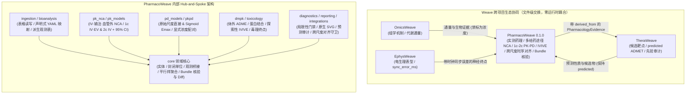
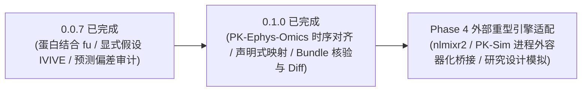

# PharmacoWeave 项目设计评估与下一阶段实施方案

> **文档版本**：v3.0  
> **更新日期**：2026-10-31  
> **适用版本**：PharmacoWeave 0.1.0 (Phase 3 闭环)  
> **演进记录**：v1.0 基于 `0.0.1` 撰写；v2.0 升级至 `0.0.4` 基线；v2.1 升级至 `0.0.5` 基线；v2.2 记录 `0.0.6`（血管外/输注与二室模型）；v2.3 记录 `0.0.7`（蛋白结合与 IVIVE/预测审计）；本文 v3.0 升级至 `0.1.0` 基线，记录 Phase 3（研究观测桥接、跨尺度时序对齐示范流、声明式异构表映射与结果包核验工具链）的完成情况，并衔接 Phase 4 外部重型引擎适配器规划。

---

## 一、 评估概述与核心结论

PharmacoWeave 定位为**面向定量药理学研究的数据模型与验证工具包（Research-use Quantitative Pharmacology Toolkit）**，旨在解决定量药理学实验数据孤岛、跨项目证据边界混乱、单位量纲失真、BLQ（低于定量限）处理不规范以及缺乏可复现审计追踪等核心痛点。

### 综合评估结论（0.1.0 基线）

1. **设计合理性：优秀（科学严谨度高，认识论护栏与轻量工程高度统一）**  
   项目坚持“Research Use Only”定位、采用单向依赖的 Hub-and-Spoke 拓扑、构建封闭单位量纲词表、严格执行清除率与分布容积语义隔离（`CL` / `Vz` vs `CL/F` / `Vz/F`）与 BLQ 不可变审计，并建立了 5 级跨项目证据守卫。在不引入 `scipy`、`matplotlib` 或任何 copyleft 外部包的前提下，用标准库纯 Python 实现了静脉/输注/血管外 NCA、带阻尼 Levenberg–Marquardt 的一室/二室 PK 与直接/Sigmoid Emax 非线性最小二乘、$J^T W J$ 渐近不确定度推断、显式生理假设探索性 IVIVE、折叠误差校准审计、跨尺度电生理/组学对齐与原生矢量 SVG 诊断图。
2. **实现情况：`0.1.0` 圆满闭环 Phase 3 全部组学/电生理时序对齐、声明式映射与结果包核验能力**  
   打通了研究表观测（`effect` / `toxicity`）向强类型 `EffectObservation` / `ToxEndpoint` 的自动解析与桥接；实现了带严格审核通过身份链接（`review_status="accepted"`）、显式时间基准注册、时钟同步抖动（`sync_error_ms`）校验与“代谢通量绝非浓度”负向红线的跨尺度对齐（`integrations/alignment.py`）；支持声明式映射异构湿实验表格并完整保留原始文件 SHA-256 摘要（`ingest_mapping.yaml`）；交付离线结果包密码学完整性核验（`verify-bundle`）与跨运行结果包深度对比（`diff`）CLI 工具；导出并冻结第 10 份数据契约 `schemas/ingest_mapping.schema.json`。
3. **下一步演进主线清晰**  
   后续路线按科学验收切片推进：**Phase 4（外部 PopPK、PBPK、QSP 进程外适配器与研究设计模拟）**。

---

## 二、 设计的合理性评估

### 2.1 `0.1.0` 已闭环的关键里程碑能力
1. **研究目录观测向药效与毒理终点的显式桥接**：打通研究表 `observations`（`effect`、`toxicity`）向 `EffectObservation` 与 `ToxEndpoint` 的转换（`study.bridge_effects` 与 `bridge_toxicology`），自动解析关联给药事件、时间差、生物基质与量纲，附加强制性研究用局限性声明。
2. **跨尺度电生理与组学对齐及全链条可追溯性**：交付 `dose_event → in vivo exposure → EphysWeave / OmicsWeave PD endpoint → source artifact` 端到端示范流；强制校验受试者标识审核通过状态（`review_status="accepted"`）、显式注册时钟及同步抖动阈值（`sync_error_ms`）；严守“代谢通量绝不是浓度”科学红线。
3. **声明式原始异构表映射与哈希不可篡改性**：支持通过 `ingest_mapping.yaml` 映射异构湿实验导出表格（CSV/TSV/Parquet），实现列重命名、常量注入与枚举映射转换（如 `<LLOQ` / `BLQ`），将原始文件 SHA-256 摘要严格持久化至 `study.source_files`。
4. **离线结果包核验与差异对比工具链**：提供 `pharmacoweave verify-bundle`（离线逐一哈希全量落盘文件比对校验和、排查文件篡改与未列盘文件）与 `pharmacoweave diff`（对比两次分析运行的元数据差异、文件树增删改状态、Parquet 分析参数表数值相对误差与 JSON 指标变动）。
5. **全链路 CLI 与 10 份 JSON Schema 落盘**：导出并冻结 `schemas/ingest_mapping.schema.json`；CLI 支持 `verify-bundle`、`diff`、`ingest` 子命令；提供完整运行演示 `examples/multiscale_ephys_omics_alignment.py` 与 `examples/ingest_mapping_demo.py`。

### 2.2 面向 Phase 4 的后续待拓展边界
1. **进程外外部重型引擎适配器（Phase 4）**：以独立子进程和文件级交换协议桥接 `nlmixr2`（PopPK）和 `Open Systems Pharmacology / PK-Sim`（PBPK），保持核心库零 copyleft 依赖。
2. **研究设计探索性模拟（Phase 4）**：在显式模型假设与 `context_of_use` 约束下输出探索性暴露区间，严格声明不构成临床给药方案。

---

## 三、 后续分阶段实施路线（`0.1.0` → Phase 4）

各后续里程碑的详细验收切片见 `docs/roadmap.md`。
