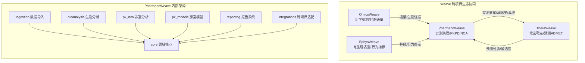
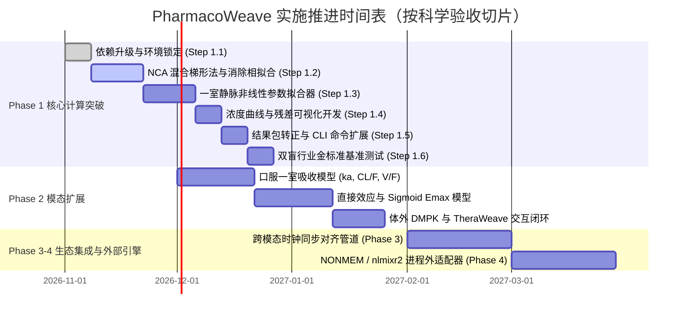

# PharmacoWeave 项目设计评估与实施方案

> **文档版本**：v1.0  
> **评估日期**：2026-10-30  
> **适用版本**：PharmacoWeave 0.0.1 (Pre-Alpha, commit `02240d9`)  
> **文档定位**：系统设计合理性评审、代码实现与文件现状评估、后续阶段落地实施方案指南  
> **与当前 main 的关系**：本文写于快进到 0.0.2 之前，描述的是 **0.0.1**。**0.0.2**（commit `7fd9028`）已经实现单次静脉推注 NCA（linear-up/log-down）、对数线性拟合回收 CL 与 V、浓度–时间 SVG，以及 `pharmacoweave nca`。下文中“NCA 计算器尚未实现”“拟合器尚未实现”“缺少浓度–时间图”只对 0.0.1 成立。当前进度以 `docs/roadmap.md` 为准。

---

## 一、 评估概述与核心结论

PharmacoWeave 定位为**面向定量药理学研究的数据模型与验证工具包（Research-use Quantitative Pharmacology Toolkit）**，旨在解决定量药理学实验数据孤岛、跨项目证据边界混乱、单位量纲失真、BLQ（低于定量限）处理不规范以及缺乏可复现审计追踪等核心痛点。

### 综合评估结论

1. **设计合理性：优秀（科学严谨度高，架构边界极其清晰）**  
   项目在科学概念与工程架构的平衡上表现卓越。坚持“Research Use Only”定位、采用 Hub-and-Spoke 依赖拓扑、首创封闭单位量纲系统、严格执行清除率语义隔离（$CL$ vs $CL/F$）及 BLQ 不可变审计，并建立了严格的跨项目 5 级证据守卫体系，有效防范了科研代码中常见的概念混淆与数据造假。
2. **实现情况：阶段性达标（Phase 0 骨架与数据契约 100% 闭环，数值计算待突破）**  
   目前严格处于规划的 **Phase 0** 阶段。实体模型、关系校验、数据读取、质控策略、结果包导出与合成数据基准已全功能实现；但非室模型（NCA）计算器与参数拟合器（Fitting）尚未落地，属于“契约与框架就绪，计算引擎待实现”状态。
3. **文件安排情况：规范度良好，存在少量冗余待清理**  
   采用标准的 `src-layout`、基于 Hatchling 的现代化 PEP 517/621 打包体系、以 Pydantic 模型为单一事实来源的 JSON Schema 自动化同步机制。但存在未跟踪的重复规划文档、未被忽略的 `.idea/` 目录以及空目录残留。
4. **后续实施路径明确**  
   路线图应全面聚焦于 **Phase 1（NCA 计算器 + 一室静脉拟合闭环）**，通过引入 `numpy/scipy/matplotlib` 基础计算依赖，突破真实数值计算瓶颈，并对照行业黄金基准完成双盲验证。

---

## 二、 设计的合理性评估



### 2.1 架构边界与定位的合理性
- **明晰的克制定位（Research Use Only）**：  
  在 `docs/feasibility.md` 中明确声明不默认具备 GxP、CDISC SEND 或 21 CFR Part 11 申报资格，避免了开源软件初期陷入过度承诺与过度合规的陷阱。
- **松耦合外部成熟引擎**：  
  明确确立“不重新造轮子开发 NONMEM 或 PK-Sim”，未来重型建模通过进程外（Out-of-Process）文件交换适配器接入，不仅降低了技术债务，也从架构上规避了 nlmixr2 / Open Systems Pharmacology 潜在的 GPL/Copyleft 许可证传染风险。
- **单向依赖拓扑（Hub-and-Spoke）**：  
  业务模块统一单向依赖 `core`，`core` 无任何上层业务依赖。跨项目交互全面基于带版本的 JSON Manifest + Parquet 文件，消除了跨仓库运行时 `import` 导致的强耦合与版本冲突。

### 2.2 领域数据模型的科学严谨性
- **受试者为唯一样本统计单元**：  
  在 `core/entities.py` 中将 `Subject` 设为独立实体与统计单元，技术平行样通过 `replicate_id` 进行关联，杜绝了将平行测定误算为自由度而导致的假阳性统计谬误。
- **动力学参数语义强隔离**：  
  - 静脉注射（IV）：强制报告清除率 $CL$ 与分布容积 $V$；
  - 血管外给药（Oral/SC）：在生物利用度 $F$ 未知时，强行要求报告表观参数 $CL/F$ 与 $V/F$，从数据模型底层杜绝了混淆生物利用度的风险。
- **双时间戳与时间基准追踪**：  
  所有生物样本同时记录带时区的绝对 ISO-8601 时间戳及相对给药时间，并引入 `timebase_id`，为跨设备的时钟对齐提供了底层支撑。
- **BLQ（低于定量下限）零容忍数值污染**：  
  BLQ、高于 ULOQ、缺失值严格禁止在 `numeric_value` 中写入数值（严禁粗暴填 0）。`bioanalysis/qc.py` 提供了 5 种符合法规要求的替换策略，替换过程记录在独立审计列，原始观测值保持只读不可变。
- **封闭单位量纲体系（Closed Unit Vocabulary）**：  
  没有盲目引入庞大而冗余的通用 Pint 库，而是构建了 5 维封闭词表（时间、药物质量、体重、体积、物质的量）。将 `kg` 限定为体重专用单位，确保 `mg/kg` 不会被通用约分化为无量纲纯数；质量浓度与摩尔浓度不自动盲目互转，必须显式提供分子量（MW）。

### 2.3 跨项目证据分级与防篡改守卫
- 设立 5 级证据分级体系：`observed`（实测）、`estimated`（估计）、`predicted`（预测）、`literature`（文献）、`hypothesis`（假设）。
- 在 `integrations/guards.py` 中实现了拦截机制：
  - 严禁外部项目在交换包中将计算通量伪装为“实测浓度”；
  - 严禁将 TheraWeave 的计算预测值（Predicted ADMET）标记为实测暴露；
  - 强制要求 EphysWeave 数据必须包含 `sync_error_ms`（时钟同步误差），杜绝无对齐基准的数据合并。

### 2.4 设计局限与待完善点
1. **多剂与稳态动力学模型表达欠缺**：当前模型对多次给药间隔（$\tau$）、稳态谷浓度（$C_{trough,ss}$）、静脉恒速输注（Infusion）的数据结构支持尚未展开。
2. **小动物破坏性采样（Destructive Sampling）支持受限**：小鼠等破坏性采血（单时间点单只动物）在统计上需依赖 Group Composite 计算 NCA，当前强约束受试者完整时间序列的校验机制在处理该场景时稍显僵硬。
3. **数据修订历史缺乏分支追踪**：目前采用新的 `run_id` 追加不可变结果包，但当上游 Assay 重新标定导致数据源修正时，缺乏细粒度的数据集版本血缘图谱。

---

## 三、 目前的实现情况评估

截至当前版本（**0.0.1 Pre-Alpha**），项目处于 **Phase 0 骨架与数据契约落地** 阶段。

### 3.1 各功能模块实现深度矩阵

| 模块分类 | 文件路径 | 规划阶段 | 实现深度 | 现状详述 |
| :--- | :--- | :--- | :--- | :--- |
| **核心领域模型** | `src/pharmacoweave/core/` | Phase 0 | **100% 完整实现** | `entities.py`、`units.py`、`validation.py`（500+ 行跨表校验）、`bundle.py`、`tables.py` 全功能运转，校验覆盖外键、时钟、基质、身份等。 |
| **数据导入与解析** | `src/pharmacoweave/ingestion/` | Phase 0 | **100% 完整实现** | `tabular.py` 完整支持 CSV、TSV、Parquet 格式的互通互转与多表解析。 |
| **生物分析质控** | `src/pharmacoweave/bioanalysis/` | Phase 0 | **100% 完整实现** | `qc.py` 实现了 5 种不可逆、带审计追踪的 BLQ 处理策略。 |
| **房室解析模型** | `src/pharmacoweave/pk_models/` | Phase 0 | **部分实现（仅解析解）** | `analytical.py` 实现了单室静脉推注的理论方程；`specs.py` 中 `estimation_implemented=False`，**非线性拟合器（Fitting）尚未实现**。 |
| **非室分析** | `src/pharmacoweave/pk_nca/` | Phase 0 | **部分实现（仅配置校验）** | `config.py` 严格校验输入配置；`runner.py` 在通过校验后**主动抛出 `PlannedCapabilityError`**，**NCA 计算引擎尚未实现**。 |
| **跨项目集成** | `src/pharmacoweave/integrations/` | Phase 0 | **部分实现（仅守卫规则）** | `guards.py` 实现了多项证据防错标规则；`external_backends.py` 目前仅为返回空列表的存根。 |
| **报告生成** | `src/pharmacoweave/reporting/` | Phase 0 | **部分实现（仅文本清单）** | `html.py` + Jinja2 模板可生成 HTML 质量检查清单，**缺乏浓度-时间曲线图及残差图**。 |
| **高级分析预留包** | `pd_models/`, `pkpd/`, `dmpk/`, `toxicology/`, `population_pk/`, `pbpk/`, `qsp/`, `simulation/` | Phase 1~4 | **预留存根（Reserved）** | 仅包含 `__init__.py` 并暴露 `STATUS` 阶段标记（`reserved`），调用被安全拦截。 |

### 3.2 自动化测试与数值基准覆盖情况
- **分层测试体系健全**：包含 `unit/`（单元测试）、`integration/`（集成测试）、`numerical_benchmarks/`（数值基准）、`schema_contracts/`（契约比对）4 个维度，共 11 个测试文件。
- **理论真值基准就绪**：`test_iv_bolus_truth.py` 锁定了无噪声单室静脉推注的解析靶值（$CL=0.20\text{ L/h/kg}, V=1.0\text{ L/kg}, AUC_\infty=5\text{ }\mu\text{g}\cdot\text{h/mL}$），为 Phase 1 计算验证打下基础。
- **Schema 自动化比对防漂移**：`test_schemas.py` 自动比对代码中 Pydantic 模型生成的 JSON Schema 与 `schemas/` 目录下的持久化文件，确保契约与代码同步。
- **当前测试盲区**：缺乏真实带噪数据测试、模型不收敛场景、边界条件（采样点数不足、外推比例过大）的容错测试。

---

## 四、 文件安排与工程结构评估

### 4.1 目录结构优点
1. **标准的 `src-layout` 架构**：源码位于 `src/pharmacoweave/` 下，有效隔离了开发环境与构建环境，避免本地隐式路径导入。
2. **Schema 驱动开发**：`schemas/` 集中持久化 5 份标准 JSON Schema（`result_bundle`、`evidence_exchange`、`pharmacology_study`、`analysis_records`、`nca_config`），形成明确的对外契约规范。
3. **合成数据样例完整**：`examples/data/iv_bolus_single_dose/` 提供了高质量的静脉推注研究样例；`examples/cross_project_demo/` 提供了跨项目正反例测试数据。

### 4.2 现状问题与文件冗余清单
1. **重复文档冗余**：根目录下的 `docs/pharmacoweave_development_plan.md`（未跟踪文件）与已入库的 `docs/development-plan.md` 内容完全重复（仅行尾换行符微差），存在文档维护漂移隐患。
2. **Git 忽略项遗漏**：`.idea/`（PyCharm 配置文件）出现在未跟踪文件列表中，需在 `.gitignore` 中完善。
3. **空目录残留**：`docs/arch_design/` 为空目录，未存放任何实质设计稿。
4. **占位测试目录**：`tests/regression/` 仅有说明性 `README.md`，缺乏实质性的数值回归基准数据。
5. **本地开发便捷脚本缺失**：缺少根级 `Makefile`，开发者在运行 lint、typecheck、test 以及重新生成 Schema 时需要手动输入较长命令。

---

## 五、 分阶段实施方案与技术蓝图

基于现有 Phase 0 基础，制定从 **Phase 1 核心攻坚** 到 **Phase 4 远期演进** 的落地路线图。



---

### 5.1 第一阶段（Phase 1）：NCA 计算器与一室静脉拟合（实施核心）

#### Step 1.1：依赖扩展与环境配置
修改 `pyproject.toml`，在核心依赖中加入数值计算与绘图库：
```toml
dependencies = [
    # 既有依赖保留 ...
    "pandas>=2.1",
    "pyarrow>=14",
    "pydantic>=2.10",
    "jinja2>=3.1",
    "PyYAML>=6",
    "jsonschema>=4.20",
    # 新增科学计算与可视化依赖
    "numpy>=1.26",
    "scipy>=1.12",
    "matplotlib>=3.8",
]
```

#### Step 1.2：实现 NCA 算法引擎（重写 `pk_nca/runner.py`）
按照 `configs/nca_single_dose_iv.yaml` 严格实现单室静脉推注非室计算：
1. **上升支线性、下降支对数梯形积分（Linear-Up / Log-Down Trapezoidal Rule）**：
   - 当 $C_{i+1} \ge C_i$ 时：
     $$AUC_{i \to i+1} = \frac{C_i + C_{i+1}}{2} \cdot (t_{i+1} - t_i)$$
   - 当 $C_{i+1} < C_i$ 时：
     $$AUC_{i \to i+1} = \frac{C_i - C_{i+1}}{\ln(C_i / C_{i+1})} \cdot (t_{i+1} - t_i)$$
2. **终末相消除速率常数 $\lambda_z$ 自动回归选点算法**：
   - 过滤条件：仅选取 $t \ge T_{max}$ 之后的有效测定点（排除前置点与 BLQ 点）；
   - 滑动窗口遍历：选取连续不少于 3 个点（`lambda_z_min_points >= 3`），进行 $\ln(C) \sim t$ 的单变量线性回归；
   - 择优策略：选取调整决定系数最大（$R^2_{adj} \ge 0.90$）且斜率为负的区间；
   - 计算终末半衰期：$t_{1/2} = \frac{\ln(2)}{\lambda_z}$。
3. **外推与核心 PK 参数集派生**：
   - 终末外推面积：$AUC_{extrap} = \frac{C_{last}}{\lambda_z}$；
   - 理论总暴露：$AUC_\infty = AUC_{last} + AUC_{extrap}$；
   - 外推占比：$Extrap\% = \frac{AUC_{extrap}}{AUC_\infty}$。若 $Extrap\% > 0.20$，在参数记录中附加警告标记；
   - 全身清除率与表观分布容积：$CL = \frac{Dose}{AUC_\infty}$，$V_z = \frac{CL}{\lambda_z}$，$MRT = \frac{AUMC_\infty}{AUC_\infty}$。
4. **异常防御与质量控制**：
   - 若有效点数 $<3$ 或 $R^2_{adj} < 0.90$，则将 $\lambda_z, t_{1/2}, AUC_\infty, CL, V_z$ 置为空值（`None`），并在诊断中输出 `lambda_z_unqualified`，严禁产生不实数据。

#### Step 1.3：实现一室静脉推注非线性参数拟合器（Fitting Engine）
在 `pk_models/` 模块下新增 `fitter.py`：
1. **拟合模型与优化目标**：
   - 基于闭式解析解：$C(t) = \frac{Dose}{V} \cdot \exp\left(-\frac{CL}{V} \cdot t\right)$；
   - 使用 `scipy.optimize.curve_fit` 实现加权非线性最小二乘法（Weighted NLLS）；
   - 权重方案支持：不加权（$w_i = 1$）、相对误差加权（$w_i = 1/y_i$ 或 $1/y_i^2$）。
2. **模型结果构建**：
   - 实例化 `ModelFit` 与 `ParameterEstimate` 实体；
   - 导出参数估计值、渐近标准误（SE）、变异系数（CV%）、95% 置信区间；
   - 输出模型收敛标志（`converged=True`）、残差平方和（SSR）、赤池信息量准则（AIC）与贝叶斯信息量准则（BIC）。

#### Step 1.4：开发图形化诊断与报告系统
在 `reporting/` 模块下新增 `figures.py`，采用无头模式（Agg）生成标准矢量图与高清位图：
1. **浓度–时间曲线图（双坐标体系）**：
   - 线性坐标系（直观反映 $C_{max}$ 与早期分布）；
   - 半对数坐标系（清晰展示终末消除线性相及 LLOQ 阈值水平线）；
   - 叠加展示观测散点、模型拟合轨迹以及 NCA 终末相回归选点区间。
2. **模型拟合诊断图（Goodness-of-Fit Residuals）**：
   - 观测值 vs 预测值散点图（Observed vs Predicted）；
   - 加权残差 vs 时间分布图（Weighted Residuals vs Time）。
3. **图表与 HTML 报告整合**：
   - 图表导出至结果包的 `figures/` 子目录，并在 HTML 报告中实现内嵌渲染展示。

#### Step 1.5：结果包状态升级与 CLI 命令扩建
- 升级 `core/study.py`：
  - 计算成功后，将 `ResultBundleManifest.analysis_executed` 置为 `True`；
  - 正式输出 `analysis/nca_parameters.parquet` 与 `analysis/model_fits.parquet`；
  - 自动从 `omitted` 缺席清单中剔除已成功运算的分析制品。
- 完善 CLI 入口（`cli.py`）：
  - 增加命令：`pharmacoweave nca run --study <path> --config <path> --output <bundle>`；
  - 增加命令：`pharmacoweave fit run --study <path> --model one_compartment_iv_bolus`。

#### Step 1.6：行业金标准双盲交叉验证
- 在 `tests/regression/` 中建立基准测试库：
  - 引入由公认标准工具（如 R 语言 `PKNCA` 包或 Phoenix WinNonlin）计算的参考数据集；
  - 编写自动化比对测试：断言 PharmacoWeave 在相同数据输入下，算出的 $AUC_{last}$、$AUC_\infty$、$\lambda_z$ 与外部参考值的相对误差必须在容许范围内（$< 10^{-4}$）。

---

### 5.2 第二阶段（Phase 2）：多途径给药与模态拓展（PD、DMPK）
1. **口服一室吸收模型（Oral Administration）**：
   - 增加血管外给药解析解：
     $$C(t) = \frac{Dose \cdot k_a \cdot F}{V(k_a - k_e)} \cdot \left(e^{-k_e t} - e^{-k_a t}\right)$$
   - 严格落实语义规则：拟合输出表观分布容积 $V/F$ 与表观清除率 $CL/F$。
2. **药效学（PD）基础模型实现**：
   - 激活 `pd_models/` 模块，落地直接效应 $E_{max}$ 与 Sigmoid $E_{max}$（Hill 方程）：
     $$E = E_0 + \frac{E_{max} \cdot C^\gamma}{EC_{50}^\gamma + C^\gamma}$$
   - 实现浓度观测值与效应观测值的时间对齐匹配。
3. **体外 DMPK 数据模型与 TheraWeave 交互闭环**：
   - 在 `dmpk/` 中定义微粒体代谢稳定性（$t_{1/2}, CL_{int}$）、血浆蛋白结合率（$f_u$）、Caco-2 膜通透性实体；
   - 形成跨项目闭环：接收 TheraWeave 预测 ADMET $\to$ 指导实测 DMPK 实验 $\to$ 形成带 `derived_from` 的实验证据回传。

---

### 5.3 第三与第四阶段（Phase 3~4）：多模态时序对齐与外部引擎适配
1. **多模态高精度时间对齐引擎（Phase 3）**：
   - 针对 EphysWeave（电生理）和 OmicsWeave（代谢组学），基于 `timebase_id` 和 `sync_error_ms` 实现跨设备时间序列插值与对齐算法。
2. **重型建模引擎进程外适配器（Phase 4）**：
   - 在 `integrations/external_backends.py` 中落地子进程控制：
     - 自动组装控制流与数据表（如 NONMEM `.ctl` / `.csv`）；
     - 通过独立子进程异步调用外部后端；
     - 结构化提取外部输出结果，封装为统一的 `PharmacologyResultBundle`。

---

## 六、 近期工程化治理清单（Quick Wins）

为保证项目代码库的清爽整洁与高效协同，建议立即执行以下 4 项治理动作：

### 1. 清理未跟踪的冗余规划文件
```powershell
# 删除重复的未跟踪规划文件，保留已纳入版本管理的权威正本 docs/development-plan.md
Remove-Item docs/pharmacoweave_development_plan.md
```

### 2. 完善 `.gitignore` 配置
在根目录 `.gitignore` 文件末尾追加忽略规则，防止 IDE 与临时文件污染版本库：
```gitignore
# IDE & Editors
.idea/
.vscode/
*.sublime-*

# Build & Distribution
dist/
build/
*.egg-info/

# Local Output Bundles & Temp Test Dumps
bundle_output/
*.log
```

### 3. 清理空目录
清理 `docs/arch_design/` 空目录，或在该目录下放入由 Mermaid 导出的高分辨率架构 SVG/PNG 图解。

### 4. 引入项目级 `Makefile`
在项目根目录创建 `Makefile`，降低开发者执行规范化检查的心智负担：
```makefile
.PHONY: install lint test schemas format clean

install:
	pip install -e ".[dev]"

lint:
	ruff check src tests examples
	mypy src/pharmacoweave

format:
	ruff format src tests examples

test:
	pytest -v

schemas:
	python -m pharmacoweave.schema_export

clean:
	find . -type d -name "__pycache__" -exec rm -rf {} +
	find . -type f -name "*.pyc" -delete
```

---

## 结语

PharmacoWeave 当前展现出**极高水准的科学架构设计与严谨的数据契约约束**，成功规避了学术开源工具普遍存在的概念混淆与代码脆弱问题。只要稳扎稳打完成 **Phase 1 的数值计算攻坚**，项目将迅速演进为一个科学公信力高、数据流转可信、高度可复现的现代化定量药理学学术工具包。
