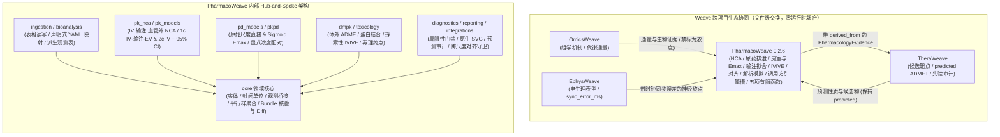
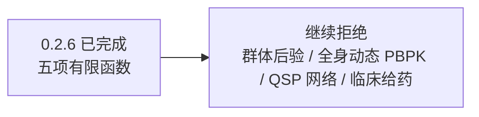

# PharmacoWeave 项目设计评估与下一阶段实施方案

> **文档版本**：v3.9  
> **更新日期**：2026-11-10  
> **适用版本**：PharmacoWeave 0.2.6  
> **演进记录**：v1.0 基于 `0.0.1`；v2.x 记录至 `0.0.7`；v3.0 记录 `0.1.0`；v3.1–v3.3 记录 `0.2.0`–`0.2.2` 的功能落地；v3.4 记入 0.2.3 的一室恒速输注拟合；v3.5 记入 0.2.4 的尿药排泄 NCA；v3.6 记入 0.2.5 的调用方进程外引擎槽；v3.7 把立项 Phase 0–4 与已落地代码对照到 0.2.5；v3.8 指向群体模型、PBPK 与 QSP 的分期计划；本文 v3.9 记入 0.2.6 的五项有限函数。

---

## 一、 评估概述与核心结论

PharmacoWeave 定位为**面向定量药理学研究的数据模型与验证工具包（Research-use Quantitative Pharmacology Toolkit）**，旨在解决定量药理学实验数据孤岛、跨项目证据边界混乱、单位量纲失真、BLQ（低于定量限）处理不规范以及缺乏可复现审计追踪等核心痛点。

### 综合评估结论（0.2.6 基线）

1. **设计边界仍然成立**  
   Research Use Only、单向 Hub-and-Spoke、封闭单位、`CL` 与 `CL/F` 隔离、BLQ 不改原值、预测与实测分层，这些决定继续约束后续实现。核心计算不引入 SciPy、Matplotlib 或 copyleft 引擎。
2. **立项 Phase 0–3 已可运行；收窄后的 Phase 4 切片已到 0.2.6**  
   可执行的是研究契约、单次与等剂量间隔 NCA、尿药排泄、已列出的房室和 Emax 拟合（含一室恒速输注的 `CL` 与 `V`）、显式假设 IVIVE、预测审计、跨尺度对齐、声明式映射、结果包核验、解析暴露模拟、调用方进程外引擎槽，以及 0.2.6 的五项有限函数：两阶段对数参数汇总、显式生理表、线性周转闭式解、肝加一个组织的代数稳态、调用方群体结果表。`schemas/` 现有 19 份契约。`population_pk`、`pbpk` 和 `qsp` 是 partial。
3. **原 Phase 4 的重型引擎没有打开**  
   立项里的群体后验、全身动态 PBPK 和 QSP 网络仍然拒绝。内置可执行后端只有 MIT 解析参考引擎。调用方引擎槽只在可执行文件、版本和许可证文本都存在时启动，不把 nlmixr2 或 PK-Sim 写进依赖。临床给药建议和隐式生理表继续拒绝。

---

## 二、 设计的合理性评估

### 2.1 `0.1.0` 已闭环的关键里程碑能力
1. **研究目录观测向药效与毒理终点的显式桥接**：打通研究表 `observations`（`effect`、`toxicity`）向 `EffectObservation` 与 `ToxEndpoint` 的转换（`study.bridge_effects` 与 `bridge_toxicology`），自动解析关联给药事件、时间差、生物基质与量纲，附加强制性研究用局限性声明。
2. **跨尺度电生理与组学对齐及全链条可追溯性**：交付 `dose_event → in vivo exposure → EphysWeave / OmicsWeave PD endpoint → source artifact` 端到端示范流；强制校验受试者标识审核通过状态（`review_status="accepted"`）、显式注册时钟及同步抖动阈值（`sync_error_ms`）；严守“代谢通量绝不是浓度”科学红线。
3. **声明式原始异构表映射与哈希不可篡改性**：支持通过 `ingest_mapping.yaml` 映射异构湿实验导出表格（CSV/TSV/Parquet），实现列重命名、常量注入与枚举映射转换（如 `<LLOQ` / `BLQ`），将原始文件 SHA-256 摘要严格持久化至 `study.source_files`。
4. **离线结果包核验与差异对比工具链**：提供 `pharmacoweave verify-bundle`（离线逐一哈希全量落盘文件比对校验和、排查文件篡改与未列盘文件）与 `pharmacoweave diff`（对比两次分析运行的元数据差异、文件树增删改状态、Parquet 分析参数表数值相对误差与 JSON 指标变动）。
5. **全链路 CLI 与当时的 10 份 JSON Schema**：0.1.0 导出并冻结 `schemas/ingest_mapping.schema.json`，使当时的契约达到 10 份；CLI 支持 `verify-bundle`、`diff`、`ingest` 子命令；提供完整运行演示 `examples/multiscale_ephys_omics_alignment.py` 与 `examples/ingest_mapping_demo.py`。0.2.x 又增加暴露模拟、引擎交换、尿药配置和调用方引擎槽，截至 0.2.5 共 14 份。0.2.6 再增加五项结果契约，共 19 份。暴露模拟与引擎交换契约保持 `0.2.2`。

### 2.2 `0.2.6` 已实现、部分实现与仍拒绝的功能

**可执行**

- 研究实体、封闭单位、显式分子量换算、BLQ 与平行样、声明式 `ingest_mapping.yaml`、结果包、`verify-bundle` 与 `diff`。
- 单次连续采血 NCA：静脉推注、恒速输注、口服、皮下、肌注。等剂量且等间隔时，`repeated_equal` 报告区间 `AUC_tau`；`steady_state` 由调用方声明后，清除率才是 Dose/AUC_tau，血管外为 Dose/(CL/F)。
- 尿药排泄：单独配置。排泄量是浓度乘以记录体积。BLQ 与缺失体积保持为空。肾清除使用调用方给出的血浆 AUC，并与血浆清除率分开存放。
- 拟合：一室静脉推注、一室恒速输注（`CL`、`V`）、一室血管外、二室静脉推注，以及直接效应和 Sigmoid Emax，含渐近标准误与 95% 置信区间。输注时长缺失、时长不短于观察窗或不可辨识时不输出清除率。
- 显式生理假设的 Well-Stirred IVIVE，以及预测对体内估算的折叠误差审计。
- 解析模拟：单次、等剂量重复和稳态。可选 `parameter_correlation`，相关写在对数参数尺度上。内置可执行后端只有 MIT 的 `pharmacoweave-analytical` 子进程。调用方另给可执行文件、版本和许可证文本时，可以单独启动该文件并记录哈希。
- 0.2.6 有限函数：已有个体估计的几何均值与对数方差；调用方生理表校验；一条线性周转方程的闭式解；肝加一个组织的代数稳态；调用方群体结果表。预测结果保持 `predicted`。两阶段汇总写明它不是 NLME 后验。

**只覆盖已写明的模型**

- 房室拟合没有三室。药效没有滞后和间接反应。IVIVE 没有隐式物种表，也不能换成体内实测清除率。相关矩阵不是群体后验。报告是 HTML 和 SVG，没有 PDF 或申报包。

**继续拒绝**

- 稀疏采样、破坏性采样、剂量或间隔不相等。
- 进程内群体后验、全身动态 PBPK、QSP 网络，以及把 nlmixr2 或 PK-Sim 引进 import 图。`run_in_process` 继续拒绝这三项。
- 临床给药建议、SEND 符合性声明、21 CFR Part 11。

---

## 三、 立项阶段与 0.2.6 代码的对照

| 立项阶段 | 原规划要交付的内容 | 0.2.6 的实现情况 |
|---|---|---|
| Phase 0 | 可安装包、示例研究、Schema 与许可证 | 已完成（0.0.1）。包名是 PharmacoWeave。 |
| Phase 1 | 导入、BLQ、NCA、基础拟合、诊断、报告和结果包 | 已完成，并超出第一刀：单次静脉、输注、血管外 NCA，等剂量间隔 NCA，尿药排泄，一室静脉、一室输注、一室血管外和二室静脉拟合。 |
| Phase 2 | 暴露–效应、体外 ADME、毒理记录和证据回传 | 已完成直接效应与 Sigmoid Emax、体外 ADME、显式假设 IVIVE、毒理终点和预测审计。间接反应没有做。 |
| Phase 3 | 组学与电生理终点对齐，能追溯到源文件 | 已完成对齐、声明式映射、`verify-bundle` 与 `diff`。代谢通量不能标成浓度。 |
| Phase 4 原意 | 接入经过验证的 PopPK、PBPK、QSP 引擎 | 重型算法未实现。0.2.6 落地五项有限函数。nlmixr2 与 PK-Sim 只登记许可证。 |
| Phase 4 收窄后的顺序 | 解析暴露、重复与稳态、间隔 NCA、对数相关、输注拟合、尿药 NCA、调用方引擎槽 | 已完成，对应 0.2.0 至 0.2.5。调用方引擎槽不解释子进程输出，也不构成给药建议。 |

## 四、 0.2.6 之后仍拒绝的范围

上表里收窄后的 Phase 4 和 0.2.6 的五项有限函数已经完成。调用方引擎槽只在可执行文件、版本和许可证文本都存在时启动子进程，并记录文件哈希；缺任何一项则零子进程。MIT 参考引擎仍可运行。nlmixr2 与 PK-Sim 不进入依赖，包内也不重写 NONMEM 或 PK-Sim。细则见 `docs/validation.md`。

| 状态 | 目标 | 实现细则 | 验收 | 明确不做 |
|---|---|---|---|---|
| 维持拒绝 | 群体后验、全身动态 PBPK、QSP 网络、间接反应、效应滞后、不等剂量方案、临床给药 | 三个模块的 `run_in_process` 继续拒绝。新算法没有冻结参考就不得出现在公开函数里。 | 现有拒绝测试保持失败。 | 不把对数相关矩阵或两阶段几何均值解释成群体清除率。 |

稀疏采样和破坏性采样需要另一套估计，不能并进现在的连续采血 NCA。效应滞后和间接反应在有独立基准之前保持拒绝。

`docs/phase4-population-pbpk-qsp.md` 第 1 至第 5 项已在 0.2.6 落地。进程内群体后验、全身动态 PBPK 和 QSP 网络仍停在各自的冻结参考出现之前。
