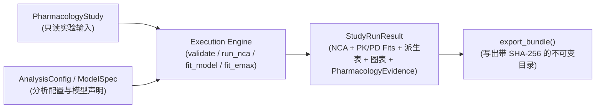
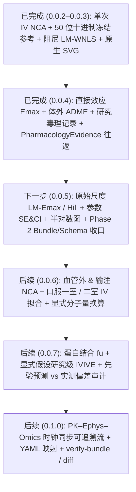
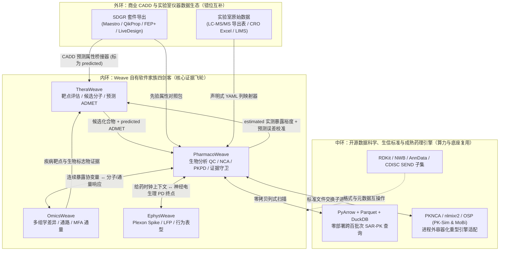

# PharmacoWeave 流程优化、SDGR 对比与生态整合战略方案

> **文档版本**：v1.1  
> **更新日期**：2026-10-30  
> **适用版本**：PharmacoWeave 0.0.4 (Pre-Alpha, commit `8ad0585`) 及 `0.0.5`–`0.1.0` 演进规划  
> **关联文档**：`docs/roadmap.md`、`docs/project-evaluation.md`、`docs/architecture.md`、`docs/development-plan.md`  
> **文档定位**：针对运行时管线与研发步骤的修订方案、对标 SDGR（Schrödinger）软件套件的异同剖析、核心差异化创新路径及三层生态整合蓝图  
> **与当前 main 的关系**：本文初版写于 `0.0.1`；截至 **0.0.4**（commit `8ad0585`），单次静脉推注 NCA、50 位十进制冻结参考、纯 Python 阻尼 LM 加权非线性拟合、标准库原生 SVG 浓度/残差图，以及带 `derived_from` 的 `PharmacologyEvidence` 往返均已落地，且核心包保持零 SciPy / Matplotlib 必装依赖。下文中的派生分析数据集落盘、原始空间 Emax 非线性拟合、声明式列映射、预测偏差审计及跨项目时序对齐已纳入 `0.0.5`–`0.1.0` 路线（详见 `docs/roadmap.md`）。

---

## 一、 执行流程与研发步骤的修改及改进方案

结合当前代码实现（`src/pharmacoweave/`）与既有路线规划（`docs/roadmap.md`、`docs/project-evaluation.md`），需从 **运行时数据与分析执行链路（Runtime Pipeline）** 和 **工程研发推进顺序（Development Steps）** 两个层面对现有流程进行演进优化。

### 1.1 运行时执行链路（Runtime Pipeline）的四项结构性修正

#### 修正 1：解耦只读输入 `PharmacologyStudy` 与单次运行产物 `StudyRunResult`
- **现状分析**：
  - `Record` 基类配置为 `frozen=True`（不可变模型），`study.attach_candidates()` 返回新实例而非原地修改。
  - 在 `0.0.2`–`0.0.3` 中，`export_bundle()` 通过可选参数接收 `nca_results` 与 `model_fits` 保持了 `PharmacologyStudy` 只读；随着 `0.0.4` 引入 `DirectEmaxFit`、`InVitroAdmeRecord`、`ToxEndpoint` 和新生成的 `PharmacologyEvidence`，扁平参数列表逐渐膨胀，适合聚合为统一的单次运行产物容器。
- **改进方案**：
  引入独立的单次运行结果聚合对象 `StudyRunResult`（或扩展结构化运行上下文），将运行流收拢为纯函数式三段管道：



- **推荐目标 API 形态**：
  ```python
  from pharmacoweave import PharmacologyStudy
  from pharmacoweave.pk_nca import load_nca_config, execute_nca

  study = PharmacologyStudy.from_files("data/experiment_001/", mode="research")
  study = study.attach_candidates("theraweave_candidates/admet.json")

  nca_cfg = load_nca_config("configs/nca_single_dose_iv.yaml")
  run_result = execute_nca(study, config=nca_cfg, run_id="study_001_nca_run_01")
  manifest = run_result.export_bundle("results/study_001_nca_run_01/")
  ```

#### 修正 2：补齐悬空的“分析数据集派生层（Derived Analysis Dataset / ADPC 层）”
- **现状痛点**：
  - `bioanalysis/qc.py` 中的 `apply_blq_policy()` 生成了不可变的 `AnalysisObservation`，但目前在整个运行链路中仍未与 `core/profiles.py` 贯通，在 `core/bundle.py` 的 `_PATHS` 清单中也未定义落盘路径。
  - `core/profiles.py` 已实现受试者级浓度时间轴提取与量纲统一，但尚缺对技术平行样（`replicate_id`）的可审计聚合辅助函数（`collapse_replicates`）。
- **改进方案（目标版本 `0.0.5`）**：
  在跨表校验通过之后、进入 NCA 或非线性拟合之前，显式串联派生分析层，并将派生结果写入 `analysis/derived_observations.parquet`：
  1. **单位标准化**：按目标分析量纲统一转换时间（如 `h`）、浓度（如 `ug/mL` 或显式分子量下的 `nmol/L`）与剂量单位；
  2. **BLQ 与超限规则派生**：调用 `apply_blq_policy()`，保留原始 `Observation` 不变，生成带 `rule` 与 `caution` 审计字段的派生列；
  3. **平行样处理**：显式按配置聚合同一 `sample_id` 下的 `replicate_id` 记录并记录聚合前离散度（CV%）；
  4. **异常与排除过滤**：对标记了 `exclusion_reason` 的点设置 `included=False`，确保不进入积分/拟合但完整保留在派生表审计记录中。

#### 修正 3：演进为职责正交的“三级递进校验门禁（3-Stage Validation Gate）”
- **现状与进展**：
  - `0.0.2`–`0.0.4` 已在 `core/profiles.py`、`pk_nca/`、`pk_models/` 和 `pkpd/` 中补充了单次静脉推注设计核查与瞬时浓度类型核查，但 `from_files()`、`run_nca()`、`export_bundle()` 之间仍存在重复全量校验。
- **改进方案**：
  收敛为职责正交的三级门禁：
  - **L1 记录模式门禁（Schema & Record Gate）**：单行字段类型、时区、封闭单位词表、BLQ 禁填数值校验（文件读取时执行一次）；
  - **L2 跨表关系与证据守卫门禁（Relational & Evidence Gate）**：外键完整性、绝对/相对时钟一致性、Assay 基质与 LLOQ 核对、跨项目证据防篡改守卫（产出可复用的 `ValidationReport` 摘要）；
  - **L3 方法学适用性门禁（Method Eligibility Gate）**：在运行具体 NCA、PK 或 PD 模型前，逐个 `Subject` 核查给药途径（IV vs Extravascular）、给药事件数（单次 vs 多次）、基质类型与有效定量点数是否满足算法前置假设；不满足时输出结构化排除原因与诊断码。

#### 修正 4：前置增加“声明式原始实验表映射器（Declarative Ingest Mapper）”
- **现状痛点**：
  - `ingestion/tabular.py` 要求输入 CSV/Parquet 列名严格对齐内部标准字段，而实验室 LC-MS/MS 工作站（Sciex Analyst、MassLynx、Thermo Xcalibur）或 CRO 交付的原始宽表/异构长表列名差异极大，人工改表既易出错又会破坏原始文件的哈希溯源链。
- **改进方案（目标版本 `0.1.0`）**：
  支持可选的 `ingest_mapping.yaml` 映射配置：先对未经手工篡改的实验室原始导出文件计算 `source_files.json` SHA-256 摘要，再通过声明式列映射、单位绑定与宽表转长表（melt）规则在内存中构建 `PharmacologyStudy`。

---

### 1.2 研发推进步骤（Development Roadmap）落地状态与后续切片

结合 `0.0.2`–`0.0.4` 的实际工程验证，研发推进顺序确定如下：



1. **Benchmark-First 准则持续生效**：
   `0.0.3` 已通过 50 位十进制独立手算参考 `iv_bolus_quiet_nca.json` 证明了无需引入第三方包即可建立高精度回归真值。`0.0.5` 的带噪 Emax / Hill 与 `0.0.6` 的血管外/输注 NCA 继续严格执行“先冻结基准与退化失败用例，再开放公开函数”。
2. **坚持零重型必装依赖策略**：
   `0.0.2`–`0.0.4` 已证明标准库数学原语足以支撑阻尼 Levenberg–Marquardt 非线性最小二乘和原生 SVG 矢量诊断图。后续一室口服、二室静脉与直接效应 Sigmoid Emax 继续沿用该纯 Python 数值内核，将重型科学计算或化学信息学组件（如 RDKit、DuckDB）严格限制在可选扩展或进程外适配器中。
3. **从内存级 `PharmacologyEvidence` 升级到结果包级闭环（`0.0.5`）**：
   `0.0.4` 已打通 `evidence_from_nca`、`evidence_from_emax`、`evidence_from_adme`、`evidence_from_tox` 的内存构建与 JSON 往返；`0.0.5` 将其正式写入 `PharmacologyResultBundle`，打通文件级交付。
4. **增强 CLI 全生命周期体验（`0.0.5`–`0.1.0`）**：
   在现有 `validate`、`capabilities`、`export-schemas`、`nca`、`fit` 基础上，解除 `nca --bundle` 与 `fit_iv_bolus` 的隐式耦合，并逐步增加 `emax`、`verify-bundle` 与 `diff` 命令。

---

## 二、 与现有 SDGR（Schrödinger 薛定谔）系列软件套件的异同点剖析

> **对标基准说明**：以下以计算药物发现行业广泛使用的 **SDGR（Schrödinger, Inc.）软件套件**（涵盖 Maestro、Glide、Desmond、FEP+、QikProp、AutoQSAR/DeepAutoQSAR、Predictive Toxicology 及企业协同平台 LiveDesign）作为参照系展开对比。

### 2.1 相同点（业务交集与共同目标）

1. **共同服务于新药研发 DMTA（Design-Make-Test-Analyze）闭环与转化降险**：两者均致力于在临床前阶段尽早识别药代动力学缺陷与潜在毒性风险，提升候选化合物（PCC）成药率。
2. **高度关注 ADMET / DMPK 核心性质表征**：SDGR 通过 QikProp、机器学习模型及脱靶物理模拟评估溶解度、膜通透性、血脑屏障穿透、血浆蛋白结合与 CYP/hERG 风险；PharmacoWeave（协同 TheraWeave）同样围绕清除率、分布容积、暴露量、体外 ADME 与毒理信号建立定量描述。
3. **强调干湿实验协同与跨学科数据汇聚**：SDGR 的 **LiveDesign** 致力于打通计算预测（*In Silico*）与实验室生物测定（*In Vitro / In Vivo* Assay）的数据孤岛；PharmacoWeave 亦以连接上游计算候选预测与下游实测生物分析数据为核心场景。
4. **面向多治疗模态拓展**：SDGR 已从小分子拓展至多肽与生物大分子（BioLuminate）；PharmacoWeave 在架构规划（`docs/development-plan.md` 第 5.4 节）中也前瞻性地为小分子、多肽、mRNA/siRNA/ASO 及基因编辑预留了差异化动力学建模边界。

### 2.2 核心不同点（多维对比矩阵）

| 对比维度 | SDGR 系列软件套件（Maestro / FEP+ / QikProp / LiveDesign） | PharmacoWeave（及所属 Weave 开源软件家族） |
| :--- | :--- | :--- |
| **底层科学范式** | **自下而上（Bottom-Up）微观物理第一性原理与结构模拟**：以量子化学（QM/MM）、分子对接、分子动力学和自由能微扰（FEP+）为核心，从三维分子与靶点结构出发做正向先验预测。 | **自上而下与中间层（Top-Down / Middle-Out）实验定量药理学**：以活体/体外实验测定数据为核心，围绕生物分析质控、NCA、PK/PD 动态反演与跨尺度暴露–效应关系做定量推断。 |
| **DMTA 主战场** | 强于 **Design（分子设计与虚拟筛选）**——解决“合成哪个分子亲和力更高、预测类药性更好”。 | 强于 **Test → Analyze（实验解析与转化证据确证）**——解决“化合物进入生物体后真实暴露如何、是否覆盖靶点有效浓度、药效与毒性时间窗如何定量”。 |
| **对“预测 vs 实测”的认识论策略** | **宽表融合与效率优先**：在 LiveDesign 中倾向于将计算预测列与实验测定列并置，用于多参数优化打分（MPO），但在导出至下游分析脚本时容易模糊证据等级与适用前提。 | **认识论强隔离与类型守卫（Epistemic Guardrails）**：在 Schema 与代码层硬编码区分 `observed / estimated / predicted / literature / hypothesis`，严禁预测属性冒充实测暴露，严禁混淆 `CL` 与 `CL/F`。 |
| **时空尺度与生物学纵深** | 聚焦 **飞秒–微秒级原子热运动** 与微观结合口袋构象；不直接处理在体多组学代谢重编程或毫秒级神经电生理功能表型。 | 聚焦 **毫秒级（电生理）至小时/天/周级（PK/PD、毒理与组学响应）** 的活体系统动力学，原生支持与多组学（`OmicsWeave`）及神经功能终点（`EphysWeave`）跨尺度对齐。 |
| **软件形态、成本与可复现工程哲学** | 商业闭源重型套件、高昂商业授权壁垒、以专有 GUI / 企业云数据库为中心，外部审稿人或合作方难以零成本重现完整计算流水线。 | MIT 开源、Python 原生、Code-First & File-First，产出带 SHA-256 校验链的不可变 `PharmacologyResultBundle`，天然适配 Git 版本控制、CI/CD 与开放科学同行复现。 |

---

## 三、 PharmacoWeave 应当体现的六大差异性与创新性方向

PharmacoWeave **不应在三维分子模拟/QSAR 赛道模仿 SDGR，也不应在重型闭源 GxP 图形界面赛道追赶传统商业 PK 软件（如 Phoenix WinNonlin）**，而应聚焦以下六个高辨识度创新支点：

### 1. “认识论感知（Epistemically-Aware）”的防幻觉药理类型系统
在自动化工作流与 AI4Science 快速普及的背景下，药理分析最隐蔽的风险是 **“证据洗白（Evidence Laundering）”**——例如把 AI/QikProp 预测的清除率当作动物实测清除率混入训练表、把 BLQ 静默替换为 0 扭曲终末半衰期、或者在拟合未收敛/未声明局限性时直接给出合格结论。
PharmacoWeave 将 **封闭量纲词表、给药途径语义绑定（`CL` vs `CL/F`）、可审计非破坏性 BLQ 派生、终末相准入判据、跨项目证据守卫以及强制填写的 `context_of_use` / `limitations`** 直接编译进 Pydantic 类型系统与 JSON Schema，打造 **AI4Pharmacology 时代的确定性科学安全护栏**。

### 2. 跨时间尺度“体内药物暴露 × 神经电生理 × 动态代谢通量”联合建模锚点
这是商业 CADD 套件空白、传统 PK 软件也极少原生支持的交叉学科高地：
- **神经精神药理学（PK–Neural-PD）**：依托内置的 `timebase_id`、`sync_error_ms` 时钟同步契约和受试者 `identity_map`，严谨连接血浆/脑脊液/脑组织药物暴露曲线与 `EphysWeave` 提取的神经元发放率（Spike Rate）、局部场电位（LFP）频段功率及行为学终点，精准刻画血脑屏障穿透滞后与效应室动力学。
- **暴露驱动的代谢流药理学（PK–MFA）**：连接个体真实药物暴露与 `OmicsWeave` 的同位素代谢通量分析（MFA）及通路重编程证据，严格区分药物浓度与内源性代谢通量。

### 3. “先验计算预测 ↔ 后验体内实测”定量校准与偏差审计闭环（In Silico-to-In Vivo Audit）
传统流程中，前端计算预测（如 SDGR QikProp 或 TheraWeave 预测 ADMET）在分子送去合成并测出动物 PK 后往往被束之高阁，缺乏系统性的误差复盘。
PharmacoWeave 可基于已挂载的 `evidence_type="predicted"` 记录与实测计算的 `NcaParameterSet` / DMPK 数据，原生提供 **预测偏差定量审计器**：自动计算预测折叠误差（Fold Error）、平均绝对折叠误差（AAFE）、系统偏差（AFE）及结构系列相关性，自动标记“预测高清除但实测低清除”等异常化合物，反向指导上游计算模型重校准。

### 4. 面向新兴治疗模态的“多基质组织暴露–持久效应”原语
针对 siRNA/ASO 核酸药物、mRNA-LNP、多肽偶联物与基因编辑疗法，血浆游离浓度往往在数小时内降至 BLQ，而靶器官（肝、脑、肾等）内的活性成分与下游药效可持续数周至数月。
充分发挥 PharmacoWeave 原生区分 15+ 种生物基质（`plasma`、`csf`、`brain`、`liver` 等）与多重分析物角色（原药、递送载体、活性代谢物、靶标标志物）的优势，沉淀一套轻量开源的 **“血浆–靶组织–持久 PD 解耦建模标准模板”**。

### 5. 践行 ICH M15（MIDD）理念的“Bundle-as-Evidence”可计算证据包与差异比对
不同于传统软件输出静态 PDF 或散装 Excel，`PharmacologyResultBundle` 不仅完整封装输入文件哈希、运行环境、结构化 Parquet 表，还显式记录 **`omitted`（未执行的分析项及原因）** 与 **`limitations`（模型假设与适用边界）**。在此基础上开发 **`pharmacoweave diff <bundle_a> <bundle_b>`** 工具，可一键对比两次运行（如更换 BLQ 策略或更换误差模型前后）在入模样本、参数估计与结论风险上的精确差异。

### 6. 原生 Agent-Ready / MCP-Ready 定量药理工具内核
凭借完备的 JSON Schema 契约、结构化的 `ValidationIssue` 诊断码和拒绝静默猜值的报错机制，PharmacoWeave 天然适合封装为科研智能体（AI Agent / Model Context Protocol Server）的标准工具底座——让大模型负责自然语言交互与方案起草，由 PharmacoWeave 负责 100% 确定性的单位换算、实验数据质控、NCA/PKPD 求解与证据包签发。

---

## 四、 整合已有生态发挥软件套件优势的实施方案

建议采取 **“内环闭环筑壁垒、中环开源借算力、外环商业做互补”** 的三层同心圆生态整合策略：



### 4.1 内环整合：构建 Weave 四剑客家族的统一交换协议与三大示范工作流

1. **制定轻量化《Weave 跨项目交换元规范（Weave Common Exchange Spec）》**：
   保持四个仓库代码零运行时耦合，但对齐以下四项元数据标准：
   - 统一跨项目实体 URI 命名空间：`weave://<project>/<study_id>/<entity_type>/<id>`；
   - 统一 `identity_map` 个体映射表结构与 `review_status`（`pending` / `accepted` / `rejected`）审核语义；
   - 统一 `manifest.json` 顶层溯源字段（`schema_name`、`schema_version`、`producer`、`files` SHA-256、`derived_from`）；
   - 统一 5 级 `evidence_type` 词表（`observed`、`estimated`、`predicted`、`literature`、`hypothesis`）。
2. **打造三条跨仓库联合端到端示范管线（Flagship Cross-Weave Pipelines）**：
   - **示范管线 1（分子设计—湿实验 PK 校准飞轮）**：`TheraWeave` 导出候选分子与先验 ADMET 预测包 $\rightarrow$ `PharmacoWeave` 导入动物体内 PK 数据完成 NCA 与一室拟合，计算有效暴露窗口并输出预测偏差审计包 $\rightarrow$ 回流 `TheraWeave` 更新候选分子优先级。
   - **示范管线 2（中枢神经药物 PK–Ephys–Behavior 联合分析）**：`PharmacoWeave` 管理给药时钟与血/脑暴露轨迹 + `EphysWeave` 提供带 `sync_error_ms` 的 LFP/Spike 特征序列 $\rightarrow$ 联合建立药物暴露–神经环路电活动–行为表型时间对齐分析包。
   - **示范管线 3（实测暴露驱动的多组学剂量响应解析）**：将 `PharmacoWeave` 产出的个体级实测暴露指标（`AUC_last`、`Cmax`）导出为协变量包传入 `OmicsWeave`，替代粗糙的名义剂量分组，精准剥离个体吸收/清除差异对转录组与代谢通量的混杂影响。

### 4.2 中环整合：无缝复用开源数据湖与专业建模引擎

截至 0.2.6，本节的 DuckDB、RDKit、NWB、AnnData 和 CDISC SEND 仍未进入包。nlmixr2 与 PK-Sim 只登记许可证。`docs/phase4-population-pbpk-qsp.md` 的五项有限函数已经落地，`run_in_process` 仍拒绝群体后验、全身动态 PBPK 和 QSP 网络。已经落地的进程外路径只有 MIT 解析参考引擎，以及调用方自备可执行文件、版本和许可证文本之后才启动的引擎槽。

1. **基于 Parquet + DuckDB 构建零运维“跨批次药理证据库”**：
   由于 `PharmacologyResultBundle` 已统一采用强 Schema 约束的 Parquet 表存储，无需引入重型关系型数据库服务，仅需提供一个轻量查询模块，即可利用 DuckDB 直接跨本地或对象存储上的数百个历史 `ResultBundle` 目录执行联邦 SQL 查询（例如一键汇总某靶点项目所有批次化合物的清除率、生物利用度与 Assay BLQ 比例）。
2. **与开源标准格式及专业建模引擎分层对接**：
   - **化学信息学可选联动（RDKit）**：在可选扩展中利用 RDKit 校验 `Compound` 的 SMILES/InChIKey 一致性与精确分子量，为质量浓度与摩尔浓度安全换算提供经过核验的分子量来源；
   - **领域标准互操作**：对接 **NWB（Neurodata Without Borders）** 的时间序列同步元数据（衔接 `EphysWeave`）、**AnnData / MuData** 的样本元数据表（衔接 `OmicsWeave`），并预留面向 **CDISC SEND（PC/EX/DM 域）** 的单向导出转换器；
   - **重型引擎进程外编排**：在 Phase 4 通过标准化子进程与容器协议封装 **nlmixr2**（群体 PK/PD NLME）与 **Open Systems Pharmacology（PK-Sim / MoBi）**（全身生理药代 PBPK），由 PharmacoWeave 负责前端数据质控守卫与后端不可变结果包归档。

### 4.3 外环整合：提供 SDGR 等主流商业套件的“错位互补桥接器”

针对已部署 SDGR（Schrödinger）套件的科研课题组或生物技术团队，不采取排他替代策略，而是在 `integrations/` 下规划通用的 **外部 CADD 属性导入适配器（如 `cadd_importers/schrodinger.py`）**：
- **自动解析与证据降级保护**：读取 Maestro / QikProp / LiveDesign 导出的 SDF 或 CSV 表格，将 `QPlogPo/w`、`QPlogS`、`QPPCaco`、`QPlogBB`、`QPlogKhsa` 及 FEP+ 预测结合自由能/亲和力自动映射为标准 `EvidenceRecord`，强制绑定 `evidence_type="predicted"`、`qc_status="not_applicable"` 及工具版本溯源，严防直接混入实测表。
- **形成“上半场 SDGR 物理预测 + 下半场 Weave 实验确证”的黄金组合**：让计算化学团队继续使用熟悉的 SDGR 完成虚拟筛选，随后无缝将候选分子移交至 **PharmacoWeave + OmicsWeave + EphysWeave** 开展体内外 DMPK 质控、PK/PD 建模、组学机制解析与预测准确度闭环复盘，最大化整套软件生态的科研落地价值。

---

## 五、 已完成的行动项（原基于 `0.0.4` 基线，至 `0.1.0` 已交付）

下表各项已经实现。0.2.6 之后仍拒绝的功能见 `docs/project-evaluation.md` 与 `docs/roadmap.md`，不再以本表作为当前目标。

| 目标版本 | 行动项 | 涉及模块 / 路径 | 预期产出与科学验收标准 |
| :---: | :--- | :--- | :--- |
| **`0.0.5`** | 原始空间阻尼 LM 直接效应 / Sigmoid Emax 拟合 + 参数 `SE` / `CI` | `pd_models/emax.py`、`pk_models/wnls.py`、`tests/numerical_benchmarks/` | 替换双倒数线性化以消除噪声放大；奇异曲率比时拒绝输出 `EC50`/`hill` 与置信区间 |
| **`0.0.5`** | Phase 2 产物落盘、Schema 同步、派生表与半对数/加权残差 SVG | `core/bundle.py`、`core/profiles.py`、`reporting/figures.py`、`schema_export.py`、`cli.py` | 补齐半对数图与加权残差图；解耦 `nca --bundle` 隐式拟合；Phase 2 记录与新生成证据写入 Bundle |
| **`0.0.6`** | 单次血管外给药 / 恒速输注 NCA、口服一室 / 二室 IV 拟合与显式分子量换算 | `pk_nca/`、`pk_models/`、`core/units.py`、`tests/regression/` | 先建立 50 位十进制独立参考 JSON；口服强制 `CL/F`、`Vz/F` 且拦截 flip-flop 不可辨识 |
| **`0.0.7`** | 蛋白结合（`fu`）、显式生理假设研究级 IVIVE 与先验预测偏差审计 | `dmpk/`、`diagnostics/`、`integrations/` | 研究级 IVIVE 严格锁定 `evidence_type="predicted"`；输出 `TheraWeave`/CADD 预测 Fold Error 与 AAFE |
| **`0.1.0`** | 跨项目时序对齐可追溯流、声明式 `ingest_mapping.yaml` 与 `verify-bundle` / `diff` | `pkpd/`、`ingestion/`、`cli.py`、`examples/` | 强制校验 `review_status="accepted"`、`timebase_id` 与 `sync_error_ms`，跑通 PK–Ephys/Omics 示范管线 |
